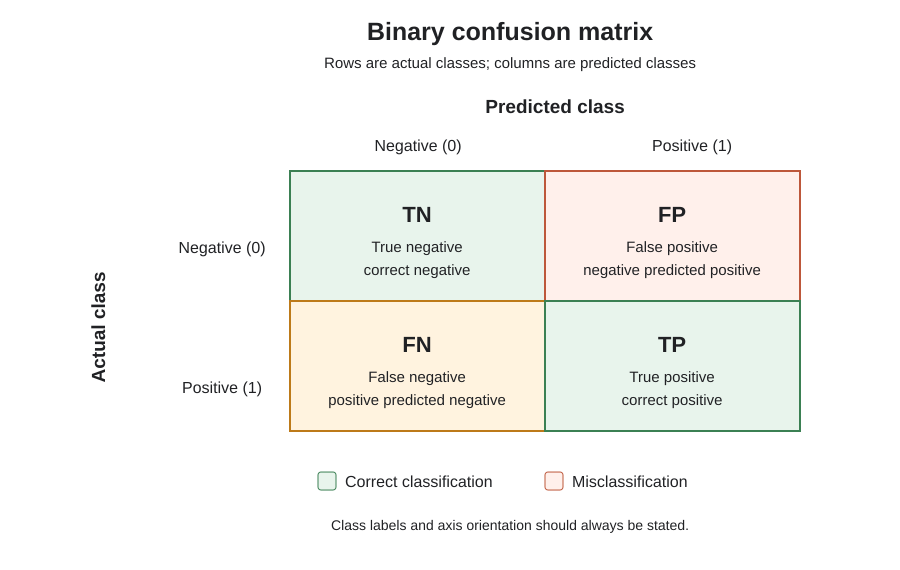

## Definition

Accuracy is the proportion of classified observations whose predicted labels match their actual labels. It counts correct positive and negative predictions alike [1].

## Calculation

For $n$ labeled observations, with actual labels $y_i$ and predicted labels $\hat{y}_i$, accuracy is:

$$
\text{Accuracy} = \frac{1}{n}\sum_{i=1}^{n}\mathbf{1}(\hat{y}_i=y_i),
$$

where $\mathbf{1}(\cdot)$ is 1 when its condition is true and 0 otherwise. In binary classification, the same quantity can be calculated from the [confusion matrix](../C/Confusion%20Matrix.md):

$$
\text{Accuracy} = \frac{TP+TN}{TP+TN+FP+FN}.
$$

Source: Original schematic for the [Confusion Matrix entry](../C/Confusion%20Matrix.md); green cells represent correct classifications [2].

## Interpretation

Accuracy ranges from 0 to 1, with larger values indicating a higher fraction of correct predictions on the evaluated sample. For example, on a dataset with 99 negative cases and 1 positive case, a classifier that predicts every case as negative has 99% accuracy but detects none of the positives [1].

Accuracy is most informative as a coarse summary when class frequencies and error costs are reasonably balanced. It treats each incorrect classification equally and does not indicate whether errors are false positives or false negatives [1].

## Necessity

Accuracy is easy to calculate and interpret and can serve as an initial summary or baseline for a classification system. It should be reported on data appropriate for the evaluation goal, not only on the data used to fit the model.

## Limitations and Alternatives

- **Class imbalance:** A classifier can have high accuracy by predicting the majority class while missing most minority-class observations.
- **Equal error weighting:** Accuracy counts a false positive and a false negative as equally incorrect, even when their consequences differ.
- **Threshold dependence:** For score-based classifiers, accuracy changes with the classification threshold.
- **It does not explain errors:** Inspect a [confusion matrix](../C/Confusion%20Matrix.md) or report metrics such as [precision](../C/Classification%20Metrics.md), [recall](../C/Classification%20Metrics.md), and F1 when the types of error matter [1].
- **Sample dependence:** An observed accuracy is an estimate based on a finite evaluation sample and may vary across samples.

## Derived Subsequent Concepts

- [**Classification Metrics**](../C/Classification%20Metrics.md): A broader family of measures for different aspects of classifier performance.
- [**Confusion Matrix**](../C/Confusion%20Matrix.md): Separates correct predictions and error types that contribute to accuracy.
- [**Precision**](../C/Classification%20Metrics.md): The fraction of predicted positives that are actually positive.
- [**Recall**](../C/Classification%20Metrics.md): The fraction of actual positives that are correctly identified.
- **Balanced Accuracy:** An alternative that averages recall across classes so that each class contributes equally.

## References

1. Google for Developers. [Classification: Accuracy, recall, precision, and related metrics](https://developers.google.com/machine-learning/crash-course/classification/accuracy-precision-recall).
2. Scikit-learn Developers. [confusion_matrix documentation](https://scikit-learn.org/stable/modules/generated/sklearn.metrics.confusion_matrix.html).
