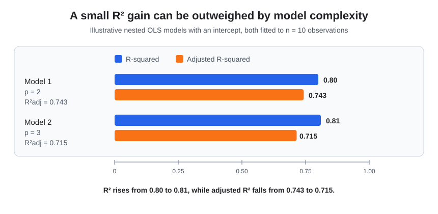
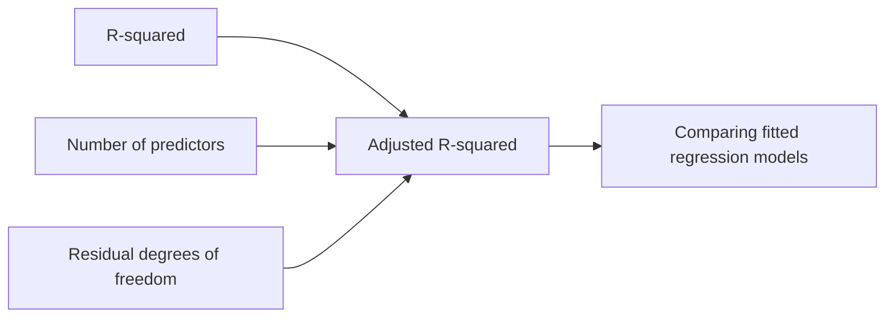

## Definition

Adjusted R-squared ($R^2_{\text{adj}}$) is a version of [R-squared](../R/R-squared.md) that adjusts the coefficient of determination for the number of estimated predictors relative to the sample size. Unlike ordinary training-set $R^2$, it can decrease when predictors are added to an ordinary least-squares model [1].

## Calculation

For an ordinary least-squares model with an intercept, $n$ observations, and $p$ predictors (excluding the intercept), the usual formula is:

$$
R^2_{\text{adj}}
= 1-(1-R^2)\frac{n-1}{n-p-1},
$$

where $n-p-1$ is the residual degrees of freedom for a full-rank model [1].

For example, consider two nested models with an intercept fitted to the same $n=10$ observations:

- With $p=2$ and $R^2=0.80$, $R^2_{\text{adj}}=1-(1-0.80)\frac{9}{7}\approx0.7429$.
- With $p=3$ and $R^2=0.81$, $R^2_{\text{adj}}=1-(1-0.81)\frac{9}{6}=0.715$.

The second model has a higher unadjusted $R^2$, but its adjusted value is lower because the increase in fit does not offset the additional predictor's degrees-of-freedom cost.

Source: Original chart of the illustrative values calculated above; these are not results from an observed dataset.

The exact expression depends on whether the fitted model includes a constant. For a model without a constant, statsmodels defines adjusted $R^2$ as $1-\frac{n}{\text{df}_{\text{resid}}}(1-R^2)$, where $\text{df}_{\text{resid}}$ is the model's residual degrees of freedom [1].

## Interpretation

- Higher adjusted $R^2$ indicates a better fit after this particular degrees-of-freedom adjustment, when comparing models fitted to the same response observations under compatible assumptions.
- Unlike ordinary $R^2$, adjusted $R^2$ can fall when adding a predictor if the improvement in residual fit is too small.
- It is not necessarily between 0 and 1; it can be negative for a poor-fitting model.

## Necessity

For ordinary least-squares models with an intercept fitted to the same response data, training-set $R^2$ cannot decrease when predictors are added, even if a predictor contributes little useful fit. Adjusted $R^2$ provides a complexity-aware summary that can help compare such models, complementing rather than replacing error measures such as [MSE](../M/Mean%20Squared%20Error.md) or held-out evaluation [1].

## Limitations and Alternatives

- **It is not a universal predictive score:** The adjustment depends on the fitted model's degrees of freedom and intercept convention [1].
- **It is not a substitute for validation:** A higher adjusted $R^2$ does not establish that a model will predict well on new observations.
- **Comparisons require compatible data:** Values from models fitted to different response samples are not directly comparable in the same way.
- **The adjustment is not a significance test or causal claim:** It does not show that a particular predictor is statistically significant or that predictors cause the response.
- **It does not replace error-scale measures:** Pair it with measures such as [RMSE](../R/Root%20Mean%20Squared%20Error.md) or [MAE](../M/Mean%20Absolute%20Error.md) when the size of prediction errors matters.

## Derived Subsequent Concepts

- [**R-squared**](../R/R-squared.md): The coefficient of determination adjusted here for model degrees of freedom.
- [**Regression Metrics**](../R/Regression%20Metrics.md): Places adjusted $R^2$ alongside error-based measures and unadjusted $R^2$.
- [**Regression**](../R/Regression.md): The quantitative prediction task whose fitted models may be compared using adjusted $R^2$.

The concept map shows the statistics and model details used to form adjusted $R^2$, and its use in comparing fitted regression models:

## References

1. Statsmodels Developers. [RegressionResults.rsquared_adj](https://www.statsmodels.org/stable/generated/statsmodels.regression.linear_model.RegressionResults.rsquared_adj.html).
