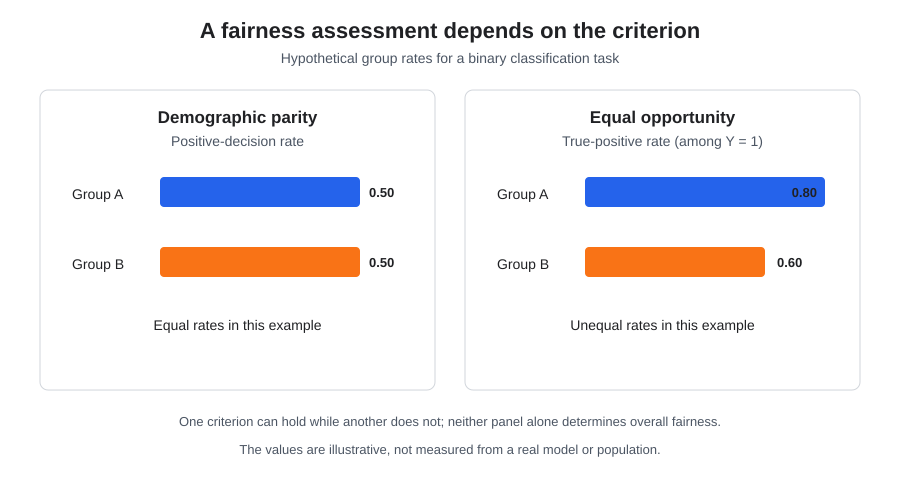
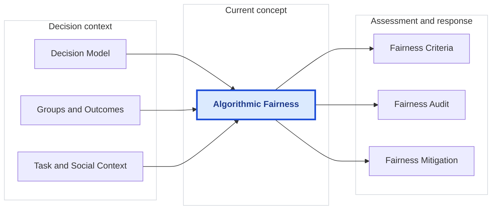

## Definition

Algorithmic fairness concerns whether decisions or outcomes produced with algorithms are justifiable and avoid unjustified, systematic disadvantage. It is not a single mathematical property: deciding what counts as fair depends on the task, affected people, institutional setting, and the values or rules that should govern the decision [1, 2].

In machine learning, fairness is often assessed using statistical criteria for groups, or by asking whether similar individuals receive similar treatment. These approaches formalize different concerns and can give different assessments of the same model [1, 2].

## Calculation

For a binary classification example, let $A$ denote group membership, $Y$ the observed outcome, and $\hat{Y}$ the model's decision. Common group criteria include [1]:

| Criterion | Comparison across groups |
| --- | --- |
| **Demographic parity** (statistical parity) | The positive-decision rate is equal: $\mathbb{P}(\hat{Y}=1\mid A=a)=\mathbb{P}(\hat{Y}=1\mid A=b)$. |
| **Equal opportunity** | The true-positive rate is equal: $\mathbb{P}(\hat{Y}=1\mid Y=1,A=a)=\mathbb{P}(\hat{Y}=1\mid Y=1,A=b)$. |
| **Equalized odds** | Both true-positive and false-positive rates are equal: $\mathbb{P}(\hat{Y}=1\mid Y=y,A=a)=\mathbb{P}(\hat{Y}=1\mid Y=y,A=b)$ for each $y\in\{0,1\}$. |

For example, suppose groups A and B each receive positive decisions at a rate of $0.50$. This satisfies demographic parity for those two groups. If their true-positive rates are $0.80$ and $0.60$, respectively, equal opportunity is not satisfied. The hypothetical chart illustrates why one fairness criterion does not stand in for all the others.

Source: Original schematic; the rates are hypothetical.

Other approaches include **calibration**, which asks whether a score corresponds to the observed outcome frequency within each group, and **individual fairness**, which asks whether similar individuals receive similar treatment according to a task-specific similarity measure [1, 2].

## Interpretation

- A metric reports whether a particular statistical condition holds for defined groups, outcomes, predictions, and data. It does not by itself establish that the overall decision process is fair.
- Demographic parity concerns positive-decision rates; equal opportunity concerns true-positive rates; equalized odds concerns both true-positive and false-positive rates.
- Group comparisons and individual-similarity approaches capture different ideas of fairness. The choice should reflect the decision's purpose and the harms or benefits that matter in context [1, 2].

## Necessity

Fairness analysis can reveal disparities in who receives an opportunity or bears a model's errors. It helps teams investigate data and model behavior, decide which outcomes to monitor, and evaluate whether proposed changes address the relevant concern. It should be part of a broader review of the decision process, not treated as a final fairness certificate [1, 2].

## Limitations and Alternatives

- **There is no universally appropriate metric:** Criteria encode different goals and can disagree on the same system [1].
- **Some criteria can be incompatible:** For risk scores, Kleinberg, Mullainathan, and Raghavan show that calibration and balance conditions cannot generally all be met when groups have different base rates, except in special cases such as perfect prediction [3]. This result applies under the assumptions and definitions in their analysis, not to every possible fairness question.
- **Group definitions matter:** Choices about which groups to compare, how to measure outcomes, and whether to examine intersections can change what an audit reveals [1, 2].
- **Omitting a sensitive feature is not sufficient:** Other variables can act as proxies, and disparities can arise through data, labels, or the surrounding decision process [1].
- **A metric can hide other harms:** Matching selected rates does not establish that the target, labels, or use of the model is appropriate.

Fairness analysis can be paired with [Dataset Bias](../D/Dataset%20Bias.md) investigation to examine data collection and measurement, and with [SHAP Values](../S/SHAP%20Values.md) to inspect feature contributions. Explanations can inform an audit, but do not themselves measure or guarantee fairness.

## Derived Subsequent Concepts

- **Demographic Parity:** A group criterion requiring equal positive-decision rates [1].
- **Equal Opportunity:** A criterion requiring equal true-positive rates across groups [1].
- **Equalized Odds:** A criterion requiring equal true-positive and false-positive rates across groups [1].
- **Fairness Audit:** A structured assessment of a system's outcomes, errors, and decision context for specified groups.
- **Fairness Mitigation:** Changes to data, model training, thresholds, or decision procedures intended to address a specified fairness concern.

The concept map shows inputs to a fairness assessment and common criteria or actions that build on it:

## References

1. Barocas, S., Hardt, M., & Narayanan, A. (2023). [Fairness and Machine Learning: Limitations and Opportunities, Chapter 3: Classification](https://fairmlbook.org/classification.html). MIT Press.
2. Barocas, S., Hardt, M., & Narayanan, A. (2023). [Chapter 4: Relative Notions of Fairness](https://fairmlbook.org/relative.html). *Fairness and Machine Learning: Limitations and Opportunities*. MIT Press.
3. Kleinberg, J., Mullainathan, S., & Raghavan, M. (2017). [Inherent Trade-Offs in the Fair Determination of Risk Scores](https://arxiv.org/abs/1609.05807). *Proceedings of ITCS 2017*.
