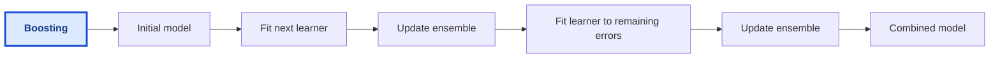

## Definition

Boosting is an ensemble learning method in which models, often called **base learners**, are added sequentially. Each new learner is trained to improve the current ensemble according to a chosen objective. In common boosting algorithms, this is done by emphasizing training examples that are currently difficult to predict or by fitting the negative gradient of a loss function.

The final model combines the contributions of its learners. A common additive form is:

$$
F_M(x) = F_0(x) + \sum_{m=1}^{M} \nu h_m(x)
$$

where $F_0$ is an initial prediction, $h_m$ is the learner added at iteration $m$, and $\nu$ is a learning-rate or shrinkage factor. The precise update and combination rule depend on the boosting algorithm.

## Calculation

Boosting does not have one universal training formula. Two influential approaches illustrate its main ideas.

### AdaBoost

In the binary classification formulation of AdaBoost, labels and predictions are represented by $y_i, h_m(x_i) \in \{-1, +1\}$. At each iteration, the algorithm fits a weak classifier using a distribution of weights over the training examples. It increases the relative weight of examples misclassified by the current learner, so later learners pay more attention to them.

For a learner with weighted error $\epsilon_m < \frac{1}{2}$, its coefficient is:

$$
\alpha_m = \frac{1}{2}\ln\left(\frac{1-\epsilon_m}{\epsilon_m}\right)
$$

The example weights are then updated proportionally to:

$$
w_i^{(m+1)} \propto w_i^{(m)}
\exp\left(-\alpha_m y_i h_m(x_i)\right)
$$

The final classifier is the sign of a weighted sum of the learners:

$$
H(x) = \text{sign}\left(\sum_{m=1}^{M}\alpha_m h_m(x)\right)
$$

### Gradient Boosting

Gradient boosting builds an additive model by fitting each new learner to the negative gradient of the loss with respect to the current predictions. For training examples $(x_i, y_i)$ and differentiable loss $L$, the pseudo-residual at iteration $m$ is:

$$
r_{im} =
-\left[
\frac{\partial L(y_i, F(x_i))}
{\partial F(x_i)}
\right]_{F=F_{m-1}}
$$

A base learner is fitted to these pseudo-residuals, and its contribution is added to the current model, often with a learning-rate factor. For squared-error regression, the negative gradient is proportional to the ordinary residual, so the procedure fits successive learners to the remaining prediction errors.

Decision trees are a common base learner for gradient boosting, producing gradient-boosted decision trees (GBDTs). Boosting itself is not restricted to decision trees; its applicable losses and base learners depend on the algorithm.

## Interpretation

The learners in a boosting ensemble are not simply trained independently and averaged. Their training is sequential: each step depends on the ensemble built so far. AdaBoost uses changing example weights, while gradient boosting uses the loss gradient to determine the direction of the next update.

The learning rate controls how much each learner changes the ensemble. In gradient boosting, using a smaller learning rate generally requires more boosting iterations to reach a comparable training fit. The number and complexity of learners, learning rate, and loss function therefore affect the resulting model.

## Necessity

Boosting provides a way to build a predictive model from a sequence of relatively simple learners. By repeatedly updating the ensemble to address its current errors or loss gradient, it can represent complex relationships that a single base learner may not capture. Gradient-boosted trees support a range of differentiable objectives and are commonly used for classification and regression, including on tabular data [1, 2].

## Limitations and Alternatives

- **Sequential fitting:** Because each learner depends on the previous ensemble, the main boosting iterations are less naturally parallel than independently trained ensemble members.
- **Model tuning:** Performance depends on choices such as the number and complexity of learners, learning rate, and objective. These should be selected using validation data or cross-validation.
- **Overfitting risk:** Adding learners or allowing overly complex base learners can fit training-specific patterns. Shrinkage and other regularization strategies can help control the fit, but do not guarantee good generalization [1, 2].
- **Sensitivity to data:** Some boosting methods can be affected by noisy examples or outliers, depending on their loss and update rule.
- **Not universally preferable:** Bagging and random forests are alternative ensemble approaches. They train estimators using randomized samples or features and combine their predictions, rather than sequentially correcting the current ensemble [1].

## Derived Subsequent Concepts

- **AdaBoost:** A boosting algorithm that adapts example weights and combines weak classifiers through weighted voting [3].
- **Gradient Boosting:** An additive modeling framework that fits successive learners to negative gradients of a specified loss [2].
- **Gradient-Boosted Decision Trees (GBDTs):** Gradient boosting models whose base learners are decision trees [1, 2].
- **Stochastic Gradient Boosting:** A gradient boosting variant that fits each iteration using a subsample of the training data [1].

## References

1. Scikit-learn Developers. [Ensemble methods: Gradient boosting, random forests, bagging, voting, and stacking](https://scikit-learn.org/stable/modules/ensemble.html).
2. Friedman, J. H. (2001). [Greedy function approximation: A gradient boosting machine](https://doi.org/10.1214/aos/1013203451). *The Annals of Statistics*, 29(5), 1189–1232.
3. Freund, Y., & Schapire, R. E. (1997). [A decision-theoretic generalization of on-line learning and an application to boosting](https://doi.org/10.1006/jcss.1997.1504). *Journal of Computer and System Sciences*, 55(1), 119–139.
