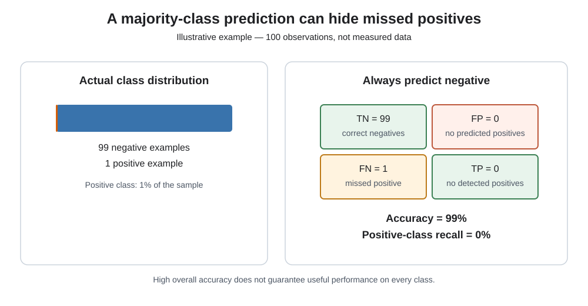

## Definition

Class imbalance describes a classification dataset in which the class frequencies differ substantially, often with one class represented by far fewer examples than another. Whether this is a problem depends on the task, the importance of each class, and the evaluation metric [1].

## Calculation

For $K$ classes and $N$ observations, let $n_k$ be the number of examples in class $k$. The class proportion is:

$$
p_k = \frac{n_k}{N}.
$$

For a binary dataset, one descriptive imbalance ratio is the number of majority-class examples divided by the number of minority-class examples:

$$
\text{Imbalance ratio} = \frac{n_{\text{majority}}}{n_{\text{minority}}}.
$$

This ratio describes the sample; there is no universal cutoff at which a dataset becomes imbalanced.

Source: Original illustrative diagram. The 99% accuracy example is described in the Google ML Crash Course [1]; the counts shown here are a constructed example, not measured data.

## Interpretation

Class imbalance does not by itself prove a classifier is ineffective. However, a model that mostly predicts the majority class can achieve high [accuracy](../A/Accuracy.md) while performing poorly on a rare class. In the illustrated 99-to-1 example, predicting every observation as negative gives 99% accuracy but zero recall for the positive class [1].

## Necessity

Checking class frequencies helps interpret evaluation results and decide which [classification metrics](./Classification%20Metrics.md) answer the task's actual question. When the minority class is important, examine class-specific performance rather than relying on accuracy alone.

## Limitations and Alternatives

- **The ratio is not a quality score:** A large imbalance ratio does not automatically imply a bad model or an invalid dataset.
- **Metric choice matters:** Report per-class outcomes and consider [balanced accuracy](https://scikit-learn.org/stable/modules/generated/sklearn.metrics.balanced_accuracy_score.html), which averages recall across classes [2].
- **Preserve the evaluation goal:** Evaluation data should reflect the intended use or explicitly state how sampling differs from it.
- **Possible training adjustments:** Class weighting or changing the classification threshold may help with a particular objective, but each changes model behavior and must be assessed on appropriate held-out data [3, 4].

## Derived Subsequent Concepts

- [**Accuracy**](../A/Accuracy.md): Overall correctness can be misleading when class frequencies are highly unequal.
- [**Classification Metrics**](./Classification%20Metrics.md): The choice of metric should reflect class frequencies and error costs.
- [**Confusion Matrix**](./Confusion%20Matrix.md): Separates prediction outcomes by actual and predicted class.
- [**Precision**](../P/Precision.md) and [**Recall**](../R/Recall.md): Class-specific metrics that describe different positive-class errors.
- **Balanced Accuracy:** The average of recall across classes [2].

## References

1. Google for Developers. [Classification: Accuracy, recall, precision, and related metrics](https://developers.google.com/machine-learning/crash-course/classification/accuracy-precision-recall).
2. Scikit-learn Developers. [balanced_accuracy_score documentation](https://scikit-learn.org/stable/modules/generated/sklearn.metrics.balanced_accuracy_score.html).
3. Scikit-learn Developers. [compute_class_weight documentation](https://scikit-learn.org/stable/modules/generated/sklearn.utils.class_weight.compute_class_weight.html).
4. Scikit-learn Developers. [Tuning the decision threshold for class prediction](https://scikit-learn.org/stable/modules/classification_threshold.html).
