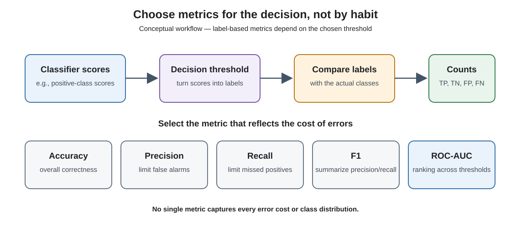

## Definition

Classification metrics are quantitative measures used to assess a classifier's predictions. Different metrics emphasize different outcomes, so the appropriate choice depends on the task, the cost of errors, class frequencies, and whether evaluation concerns predicted labels or probability scores [1, 2].

For binary classification, many label-based metrics are calculated from the four counts in a [confusion matrix](./Confusion%20Matrix.md): true positives (TP), true negatives (TN), false positives (FP), and false negatives (FN).

## Calculation

For one fixed [classification threshold](./Classification%20Threshold.md), common metrics include:

$$
\text{Accuracy} = \frac{TP+TN}{TP+TN+FP+FN}.
$$

$$
\text{Precision} = \frac{TP}{TP+FP},
\qquad
\text{Recall} = \frac{TP}{TP+FN}.
$$

$$
F_1 = 2\frac{\text{Precision}\cdot\text{Recall}}{\text{Precision}+\text{Recall}}.
$$

The [receiver operating characteristic (ROC) curve](../R/ROC%20Curve.md) evaluates the true positive rate against the false positive rate as the threshold varies. [ROC-AUC](../R/ROC-AUC.md) summarizes the area under that curve, using the classifier's scores across thresholds rather than one selected threshold [2].

Source: Original conceptual diagram based on the threshold-dependent and task-dependent metric guidance in [1, 2].

## Interpretation

- [**Accuracy**](../A/Accuracy.md) measures the fraction of all predictions that are correct.
- [**Precision**](../P/Precision.md) asks what fraction of predicted positives are actually positive; it is relevant when false alarms are costly.
- [**Recall**](../R/Recall.md) asks what fraction of actual positives are detected; it is relevant when missing positives is costly.
- [**F1 score**](../F/F1%20Score.md) summarizes precision and recall through their harmonic mean, but does not include true negatives.
- **ROC-AUC** summarizes ranking discrimination across thresholds; it does not choose a threshold for a particular decision.

These metrics answer different questions and should not be treated as interchangeable [1, 2].

## Necessity

Metric selection should reflect how predictions will be used. Accuracy can be informative when classes and error costs are reasonably balanced, but in a [class-imbalanced dataset](./Class%20Imbalance.md) it can be high even when a classifier fails to identify the minority class. Precision and recall expose different types of positive-class errors, while F1 provides a single summary of those two quantities [1].

## Limitations and Alternatives

- **Threshold dependence:** Accuracy, precision, recall, and F1 can change when the classification threshold changes. State the threshold or explain how it was selected.
- **[Class imbalance](./Class%20Imbalance.md):** Accuracy alone can conceal poor performance on a rare class.
- **Metric tradeoffs:** A threshold change may improve precision while reducing recall, or vice versa. A single metric does not encode every error cost.
- **ROC-AUC is not an operating point:** A strong ROC-AUC does not identify which threshold meets a deployment requirement; evaluate the chosen threshold and relevant error rates [2].
- **Binary formulas need multiclass choices:** For multiclass tasks, metrics may be aggregated across classes in different ways; report the averaging method as well as the score [2].
- **Undefined ratios:** Precision, recall, or F1 may have a zero denominator for some predictions or labels. Implementations differ in how they handle this case, so check the metric's documented convention.

## Derived Subsequent Concepts

- [**Confusion Matrix**](./Confusion%20Matrix.md): The table of actual versus predicted classes from which many label-based classification metrics are calculated.
- [**Accuracy**](../A/Accuracy.md): The fraction of predictions that are correct.
- [**Precision**](../P/Precision.md): The fraction of predicted positives that are truly positive.
- [**Recall**](../R/Recall.md): The fraction of actual positives that are correctly identified.
- [**F1 Score**](../F/F1%20Score.md): The harmonic mean of precision and recall.
- [**ROC Curve**](../R/ROC%20Curve.md): Plots true-positive against false-positive rates across thresholds.
- [**ROC-AUC**](../R/ROC-AUC.md): Summarizes the area under the ROC curve.
- [**Classification Threshold**](./Classification%20Threshold.md): The cutoff used to convert a classifier's score into a predicted class.

## References

1. Google for Developers. [Classification: Accuracy, recall, precision, and related metrics](https://developers.google.com/machine-learning/crash-course/classification/accuracy-precision-recall).
2. Scikit-learn Developers. [Metrics and scoring: quantifying the quality of predictions](https://scikit-learn.org/stable/modules/model_evaluation.html#classification-metrics).
