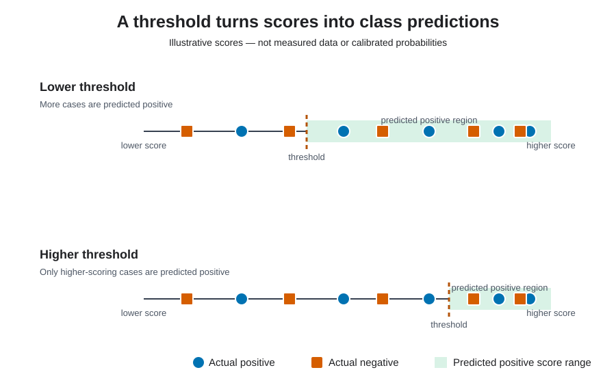

## Definition

A classification threshold is a cutoff applied to a model's score to convert it into a class prediction. In binary classification, a score at or above the threshold is assigned to the positive class, and a lower score is assigned to the negative class [1, 2].

The model's score may be a probability estimate or another decision score. A score is not necessarily a calibrated probability [2].

## Calculation

Let $s(\mathbf{x})$ be the score for an example $\mathbf{x}$ and let $t$ be the threshold. One common binary decision rule is:

$$
\hat{y}(\mathbf{x}) =
\begin{cases}
1 & \text{if } s(\mathbf{x}) \ge t, \\
0 & \text{if } s(\mathbf{x}) < t.
\end{cases}
$$

Implementations may differ in how they handle a score exactly equal to the threshold. For example, scikit-learn's default binary prediction rules use a strict greater-than comparison for their probability and decision-score cutoffs [1, 2].

Source: Original qualitative schematic based on the score-to-label rule and threshold effects described by Google for Developers [1]; the scores are illustrative, not measured data.

## Interpretation

Raising the threshold makes the classifier require a higher score before predicting positive. For a fixed set of scores, the number of predicted positives cannot increase: true positives and false positives can only stay the same or decrease, while false negatives and true negatives can only stay the same or increase. The [ROC curve](../R/ROC%20Curve.md) displays how the corresponding true-positive and false-positive rates change across thresholds [1, 3].

The threshold changes the class decisions, not the model's underlying score ranking. Consequently, changing only the threshold can move the selected operating point without changing the model's ROC curve or ROC-AUC [2].

## Necessity

A score alone does not determine what action to take. The threshold makes that decision explicit and allows a classifier's operating point to reflect the relative costs of false positives and false negatives, task requirements, and the metric being optimized [1, 2].

## Limitations and Alternatives

- **A default is not universally optimal:** A threshold of $0.5$ is a common default for probability estimates, not a rule that suits every class distribution or error cost [1, 2].
- **Threshold tuning can overfit:** Select a threshold using validation data or cross-validation, not the final test set. Repeatedly choosing it on test data makes the reported evaluation optimistic [2].
- **Metric tradeoffs depend on the task:** A threshold that improves recall may also increase false positives and reduce precision. Examine the relevant metrics and costs rather than maximizing a convenient score by default [1, 2].
- **Score meaning matters:** A cutoff on uncalibrated scores is still a decision rule, but the score should not be described as a probability unless it has that interpretation.
- **Multiclass classification requires a decision rule:** A single positive-versus-negative threshold does not by itself specify how to choose among several classes.

## Derived Subsequent Concepts

- [**Confusion Matrix**](./Confusion%20Matrix.md): Counts the outcomes produced after applying a threshold.
- [**Precision**](../P/Precision.md) and [**Recall**](../R/Recall.md): Measure different positive-class outcomes at a chosen threshold.
- [**F1 Score**](../F/F1%20Score.md): Combines precision and recall for a selected set of predictions.
- [**ROC Curve**](../R/ROC%20Curve.md): Shows the true-positive and false-positive rates over a range of thresholds.
- [**ROC-AUC**](../R/ROC-AUC.md): Summarizes the ROC curve across thresholds without selecting a single operating point.
- [**Classification Metrics**](./Classification%20Metrics.md): Surveys measures used to evaluate class predictions and scores.

## References

1. Google for Developers. [Thresholds and the confusion matrix](https://developers.google.com/machine-learning/crash-course/classification/thresholding).
2. Scikit-learn Developers. [Tuning the decision threshold for class prediction](https://scikit-learn.org/stable/modules/classification_threshold.html).
3. Scikit-learn Developers. [roc_curve documentation](https://scikit-learn.org/stable/modules/generated/sklearn.metrics.roc_curve.html).
