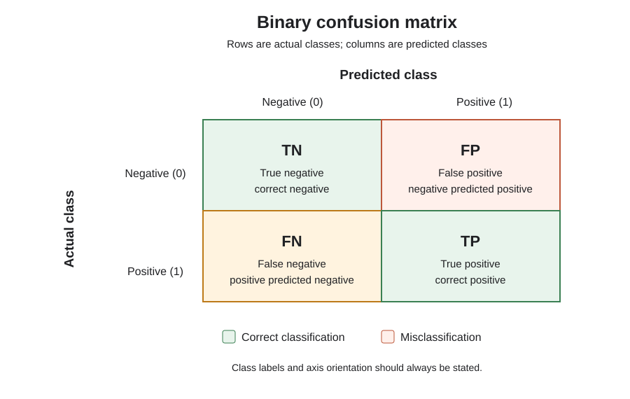

## Definition

A confusion matrix is a table that compares the actual classes with a classifier's predicted classes. Each cell counts observations with a particular actual-predicted class pair. It is the basis for many [classification metrics](./Classification%20Metrics.md) [1, 2].

## Calculation

For binary classification, let class 1 be positive and class 0 be negative. Using the convention that rows are actual classes and columns are predicted classes:

| Actual class | Predicted negative | Predicted positive |
|---|---:|---:|
| Actual negative | True negative (TN) | False positive (FP) |
| Actual positive | False negative (FN) | True positive (TP) |

Source: Original schematic for this entry. Its row-actual, column-predicted orientation follows scikit-learn; other references may transpose the axes [1, 2].

Equivalently, for a $K$-class problem, an entry $C_{ij}$ is the number of observations whose actual class is $i$ and predicted class is $j$:

$$
C_{ij} = \left|\{k : y_k=i,\ \hat{y}_k=j\}\right|.
$$

With the row-actual, column-predicted convention, the diagonal contains correct predictions and off-diagonal cells contain errors. For binary classification, TP, TN, FP, and FN can be used to calculate [accuracy](../A/Accuracy.md), [precision](../P/Precision.md), recall, and other metrics [1, 2].

## Interpretation

- **True positive (TP):** The actual class is positive and the prediction is positive.
- **True negative (TN):** The actual class is negative and the prediction is negative.
- **False positive (FP):** The actual class is negative but the prediction is positive.
- **False negative (FN):** The actual class is positive but the prediction is negative.

The row totals in this convention count actual examples per class; column totals count predictions per class. A matrix makes error types and frequently confused classes visible, while the related [classification metrics](./Classification%20Metrics.md) summarize selected aspects of those counts.

## Necessity

Overall accuracy can hide which kinds of errors a classifier makes. A confusion matrix separates correct predictions from false positives and false negatives, making it easier to choose and interpret metrics according to the consequences of each error [1].

## Limitations and Alternatives

- **Axis conventions vary:** Some references put actual classes in columns and predictions in rows. Read the labels rather than assuming an orientation [1, 2].
- **Threshold dependence:** For a score-based classifier, changing the decision threshold can change predicted labels and therefore the matrix.
- **Counts depend on class prevalence:** Large class counts can dominate the table. Row-normalized or column-normalized matrices show proportions, but normalization hides the original sample totals.
- **It does not show confidence or cost:** The matrix records discrete outcomes, not prediction probabilities or the relative consequences of different errors.
- **False positives are not automatically Type I errors:** That equivalence requires a hypothesis-testing interpretation in which a positive classification corresponds to rejecting a null hypothesis. Likewise, a false negative corresponds to a Type II error only under the matching setup.

## Derived Subsequent Concepts

- [**Classification Metrics**](./Classification%20Metrics.md): Metrics such as accuracy, precision, and recall are calculated from confusion-matrix counts.
- [**Type I Error**](../T/Type%20I%20Error.md): In a hypothesis test, rejecting a true null hypothesis; in a matching binary-classification setup, this corresponds to a false positive.
- [**Type II Error**](../T/Type%20II%20Error.md): In a hypothesis test, failing to reject a false null hypothesis; in a matching binary-classification setup, this corresponds to a false negative.
- **Classification Threshold:** A score cutoff that determines predicted labels and can change the matrix.

## References

1. Google for Developers. [Thresholds and the confusion matrix](https://developers.google.com/machine-learning/crash-course/classification/thresholding).
2. Scikit-learn Developers. [confusion_matrix documentation](https://scikit-learn.org/stable/modules/generated/sklearn.metrics.confusion_matrix.html).
