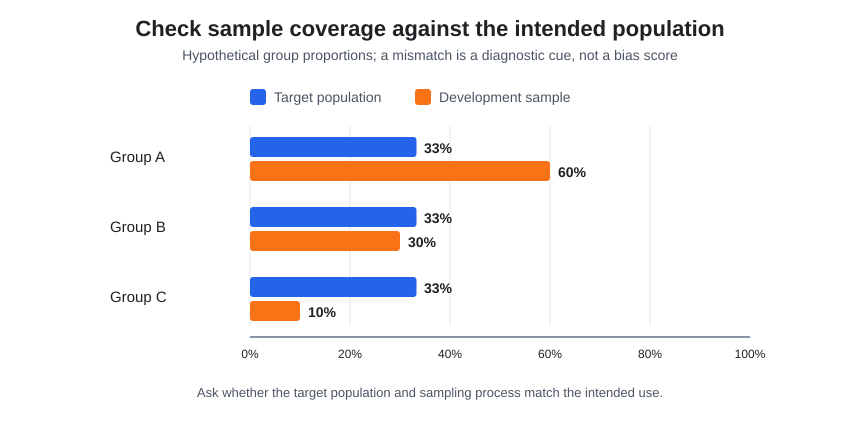
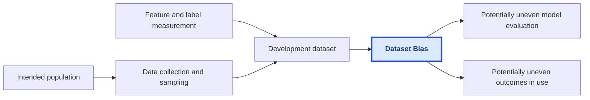

## Definition

Dataset bias is a broad, often overloaded term for systematic limitations in the data used to develop or evaluate a machine-learning system. These limitations can arise from how a target population is defined and sampled, how features or labels are measured, or how the data is prepared [1].

More precise terms can help identify the cause. For example, **representation bias** occurs when a development sample under-represents part of the population in which the model will be used. **Measurement bias** can arise when a feature or label is a poor proxy for the intended concept or is measured differently across groups [1].

## Calculation

There is no single score that measures all forms of dataset bias. A simple diagnostic for representation differences is to compare each group's share in a development sample with its share in the intended target population:

$$
\Delta_g = p_{\text{sample}}(g)-p_{\text{target}}(g),
$$

where $p(g)$ is the proportion of group $g$. For example, if groups A, B, and C each make up one-third of the target population, but the development sample contains 60%, 30%, and 10% respectively, the sample differs substantially in coverage. This difference is a reason to investigate the sampling process, not by itself a universal bias score or proof of unfairness.

Source: Original schematic using hypothetical proportions; the values are illustrative, not from an observed dataset.

## Interpretation

- Whether a dataset is representative depends on the population and use case the model is intended to serve. A sample suited to one place or time may not represent a different one [1].
- Unequal group or class proportions do not alone establish bias. They may reflect the target population; conversely, equal proportions do not rule out poor measurements, biased labels, or missing coverage [1].
- Dataset issues are only one possible source of harmful outcomes. Historical conditions, model-development decisions, evaluation, and deployment can also matter [1].

## Necessity

Examining how data was collected, who or what it represents, and how its features and labels were measured helps identify whether it supports the intended task. Dataset documentation can make the motivation, composition, collection process, and recommended uses clearer to dataset users [2].

## Limitations and Alternatives

- **No universal diagnostic:** A group-proportion comparison can reveal a possible sampling mismatch, but cannot assess every feature, label, or downstream effect.
- **Balancing is not automatically a fix:** Changing sample proportions can make data less representative of the intended use population or alter the target task.
- **More data may not address every source:** If a label is a poor proxy or reflects historical inequities, collecting more data in the same way may preserve the problem [1].
- **Avoid treating “data bias” as a complete explanation:** Specify whether the concern is sampling, measurement, labels, historical conditions, or another stage in the ML lifecycle [1].
- **Related but distinct from class imbalance:** [Class Imbalance](../C/Class%20Imbalance.md) describes unequal class frequencies in a classification dataset; it does not, by itself, establish dataset bias.

## Derived Subsequent Concepts

- [**Class Imbalance**](../C/Class%20Imbalance.md): A difference in class frequencies that may be relevant to dataset assessment but is not equivalent to dataset bias.
- [**Reproducibility in Machine Learning**](../R/Reproducibility%20in%20Machine%20Learning.md): Documenting data sources and collection details helps others understand and check an experiment.
- **Representation Bias:** Under-representation of part of the intended use population in the development sample [1].
- **Measurement Bias:** Systematic problems in how features or labels are chosen, collected, or measured [1].
- **Algorithmic Fairness:** A related area concerned with evaluating and addressing unfair outcomes in machine-learning systems.

The concept map separates potential data-generation issues from their possible downstream effects:

## References

1. Suresh, H., & Guttag, J. V. (2021). [A Framework for Understanding Sources of Harm throughout the Machine Learning Life Cycle](https://arxiv.org/abs/1901.10002). *Proceedings of the ACM Conference on Equity and Access in Algorithms, Mechanisms, and Optimization*.
2. Gebru, T., et al. (2021). [Datasheets for Datasets](https://arxiv.org/abs/1803.09010). *Communications of the ACM*, 64(12), 86–92.
