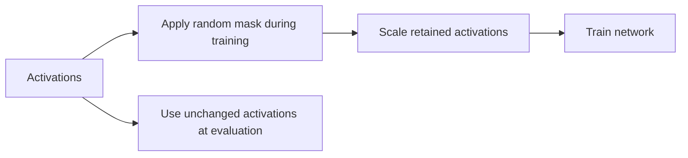

## Definition

Dropout is a regularization technique for neural networks. During training, it randomly sets selected activations to zero, so a different thinned network is used on each training pass. This discourages units from relying too heavily on particular other units, a phenomenon described as co-adaptation [1].

Dropout is a **regularization** technique, not a normalization method. Normalization methods transform or standardize activations or inputs; dropout instead applies a random mask during training to reduce overfitting.

## Calculation

Let $x$ be an activation and let $p$ be the probability of dropping it. Define a random mask $m$ by:

$$
m \sim \text{Bernoulli}(1-p)
$$

With inverted dropout, the training-time output is:

$$
\tilde{x} = \frac{m x}{1-p}
$$

The scaling keeps the expected activation unchanged, since $\mathbb{E}[\tilde{x}] = x$. At evaluation time, the random mask is not applied; implementations using inverted dropout pass the activation through unchanged [2].

For example, with $p=0.5$, each activation has a one-half probability of being set to zero during training. An activation that is kept is scaled by $1/(1-0.5)=2$.

## Interpretation

Dropout injects stochasticity into training: each forward pass uses a randomly thinned version of the network. The original paper interprets this as training many different subnetworks that share parameters; at evaluation, a single unthinned network approximates averaging their predictions [1].

The dropout probability $p$ controls the probability that an activation is removed. A larger value means more activations are dropped during training. The appropriate value depends on the model and task and should be selected using validation data.

## Necessity

Neural networks with many parameters can overfit their training data. Dropout is one method for regularizing neural networks and was introduced to reduce overfitting by preventing excessive co-adaptation of units. Its effect is not guaranteed to improve every model or task; it is a training choice to evaluate empirically [1].

## Limitations and Alternatives

- **May reduce useful capacity:** Dropping too many activations can make optimization harder or lead to underfitting.
- **Requires train/evaluation behavior to be handled correctly:** Dropout is applied during training and disabled for evaluation in the standard inverted-dropout setup [2].
- **Not a substitute for validation:** The dropout probability and its use should be evaluated on held-out data.
- **Not normalization:** Dropout does not normalize activation distributions. Batch normalization and layer normalization are examples of normalization methods with a different purpose.
- **Other regularization options:** [L1 regularization](../L/L1%20Regularization.md) and [L2 regularization](../L/L2%20Regularization.md) penalize parameter values, unlike dropout's random masking of activations. Data augmentation and early stopping are other options; their suitability depends on the model and task.

## Derived Subsequent Concepts

- **Inverted Dropout:** A common implementation that scales retained activations during training, allowing evaluation to use the identity operation [2].
- **Dropout Probability:** The probability $p$ that an activation is set to zero during training.
- **Co-adaptation:** Dependence between units that dropout aims to discourage by randomly removing units during training [1].
- **L1 Regularization:** A parameter penalty that can encourage sparse coefficients and, in linear models, feature selection.
- **L2 Regularization:** A parameter penalty that usually shrinks coefficients without setting them exactly to zero.
- **Normalization Layers:** Methods such as batch normalization and layer normalization, which normalize activations and are distinct from dropout.

## References

1. Srivastava, N., Hinton, G., Krizhevsky, A., Sutskever, I., & Salakhutdinov, R. (2014). [Dropout: A Simple Way to Prevent Neural Networks from Overfitting](https://jmlr.org/papers/v15/srivastava14a.html). *Journal of Machine Learning Research*, 15(56), 1929–1958.
2. PyTorch Contributors. [torch.nn.Dropout documentation](https://docs.pytorch.org/docs/stable/generated/torch.nn.Dropout.html).
