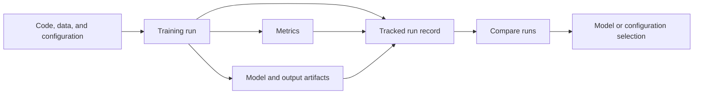

## Definition

Experiment tracking is the systematic recording and organization of machine-learning runs and their settings, results, and outputs. A run commonly represents one execution of training or evaluation; related runs can be grouped to compare model or hyperparameter choices. In MLflow's terminology, runs are grouped into experiments, though names and organization vary between tools [1].

## Calculation

Experiment tracking does not have a single mathematical formula. A simple comparison might record the learning rate and validation loss for two training runs:

| Run | Learning rate | Validation loss |
|---|---:|---:|
| A | 0.1 | 0.42 |
| B | 0.01 | 0.31 |

If both runs use the same validation data and loss definition, Run B has the lower validation loss in this illustrative example. The values are hypothetical, not results from an actual training experiment.

A useful run record can include parameters, code and data versions, evaluation metrics, and output artifacts such as model files or plots [1, 2].

## Interpretation

- A record connects a result to the settings and inputs that produced it, making runs easier to compare and revisit.
- Comparisons are meaningful only when the evaluation protocol is comparable; record which data split and metric produced each score.
- Logging results supports [reproducibility](../R/Reproducibility%20in%20Machine%20Learning.md), but does not guarantee that another run will be identical. Randomness, software versions, hardware, and nondeterministic operations can affect outcomes [2].

## Necessity

Model development often involves many training runs with different configurations. Tracking their inputs and outputs helps identify which choices produced a result, supports collaboration, and reduces reliance on informal notes or memory [1, 2].

## Limitations and Alternatives

- **A log is only as complete as its records:** Missing code, data, preprocessing, or environment versions can make a result difficult to reproduce.
- **Tracking does not validate a model:** Logged metrics still depend on appropriate data splits and evaluation procedures. Repeatedly selecting settings based on a test set can bias the final performance estimate [3].
- **More runs do not ensure better models:** The quality of comparisons depends on the chosen metrics, data, and experimental design.
- **Terminology varies:** Some tools use “experiment” for a group of runs, while others organize runs differently [1].

## Derived Subsequent Concepts

- **Training Run:** One execution of a model-training or evaluation procedure, recorded with its configuration and outputs.
- [**Hyperparameter**](../H/Hyperparameter.md): A configuration choice varied between runs, such as a learning rate.
- [**Generalization**](../G/Generalization.md): The ability to perform usefully on observations not used to fit a model.
- [**Reproducibility in Machine Learning**](../R/Reproducibility%20in%20Machine%20Learning.md): The ability to verify or repeat reported results using documented code, data, and experimental details [2].
- **Model Selection:** Choosing a model or configuration based on a prespecified evaluation procedure.

The concept map shows how tracking connects a run's inputs and outputs to comparisons between configurations:

## References

1. MLflow Contributors. [MLflow Tracking](https://mlflow.org/docs/latest/ml/tracking/).
2. Pineau, J., et al. (2021). [Improving Reproducibility in Machine Learning Research: A Report from the NeurIPS 2019 Reproducibility Program](https://jmlr.org/papers/v22/20-303.html). *Journal of Machine Learning Research*, 22(164), 1–20.
3. Cawley, G. C., & Talbot, N. L. C. (2010). [On Over-fitting in Model Selection and Subsequent Selection Bias in Performance Evaluation](https://jmlr.org/papers/v11/cawley10a.html). *Journal of Machine Learning Research*, 11(70), 2079–2107.
