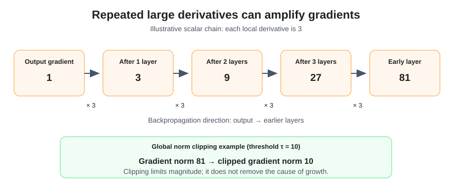
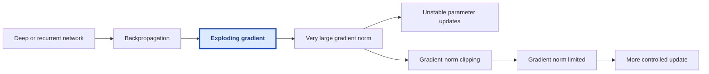

## Definition

The exploding gradient problem occurs when gradients grow excessively as they are propagated backward through a neural network. The resulting parameter updates can become so large that training is unstable or diverges. It is a known difficulty in training recurrent neural networks [1].

## Calculation

For a scalar chain of layer representations $h_0,\ldots,h_L$, the chain rule gives:

$$
\frac{\partial \mathcal{L}}{\partial h_0}
=
\frac{\partial \mathcal{L}}{\partial h_L}
\prod_{\ell=1}^{L}
\frac{\partial h_\ell}{\partial h_{\ell-1}},
$$

where $\mathcal{L}$ is the loss. In an illustrative four-layer chain, if the output gradient is $1$ and each local derivative is $3$, the gradient at the earliest representation is $1 \times 3^4=81$.

Source: Original schematic of the illustrative scalar calculation above; the values are not measurements from a trained network.

A common response is global gradient-norm clipping. For gradient vector $\mathbf{g}$ and threshold $\tau>0$, one form is:

$$
\mathbf{g}_{\text{clip}}
=
\mathbf{g}\min\left(1,\frac{\tau}{\|\mathbf{g}\|_2}\right).
$$

If $\|\mathbf{g}\|_2$ exceeds $\tau$, this scales the gradient so its norm is $\tau$; otherwise, it leaves the gradient unchanged [1].

## Interpretation

- Very large gradients can produce unusually large parameter updates, making the loss fluctuate sharply or preventing training from converging.
- Repeated multiplication by layer derivatives or Jacobians with large magnitudes can cause gradients to grow as they are propagated backward [1].
- Gradient clipping limits the size of an update caused by a large gradient; it does not by itself remove the underlying cause of instability.

## Necessity

Monitoring gradient norms and training behavior can help identify unstable updates. When gradients become excessively large, norm clipping is a practical technique used to limit them, including in recurrent neural network training [1].

## Limitations and Alternatives

- **Clipping is not a complete cure:** It limits gradient magnitude but does not guarantee stable or accurate training.
- **The threshold matters:** A threshold that is too large may provide little protection, while one that is too small can constrain useful updates.
- **It does not solve vanishing gradients:** [Vanishing Gradient](../V/Vanishing%20Gradient.md) is the opposite scaling problem, in which gradients become too small as they are propagated backward.
- **Large gradients have multiple possible causes:** Inspect the model, data, initialization, learning rate, and training diagnostics rather than treating clipping as a substitute for diagnosis.

## Derived Subsequent Concepts

- [**Vanishing Gradient**](../V/Vanishing%20Gradient.md): The contrasting problem in which backpropagated gradients shrink.
- **Gradient Clipping:** A technique that limits gradient magnitude, often by scaling a gradient vector when its norm exceeds a threshold [1].
- **Backpropagation:** The chain-rule procedure that propagates loss gradients from output layers toward earlier layers.
- **Recurrent Neural Network:** A network architecture in which repeated state transitions can make gradient propagation over long sequences difficult [1].

The concept map shows how excessive gradient growth can affect training and where clipping is applied:

## References

1. Pascanu, R., Mikolov, T., & Bengio, Y. (2013). [On the difficulty of training recurrent neural networks](https://proceedings.mlr.press/v28/pascanu13.html). *Proceedings of the 30th International Conference on Machine Learning*, 28(3), 1310–1318.
