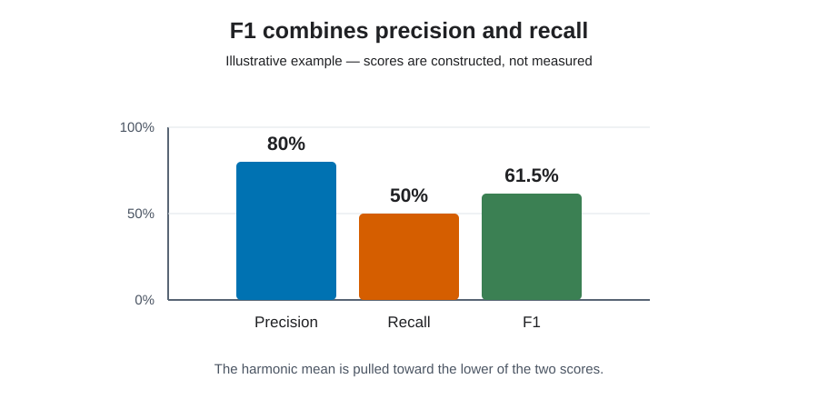

## Definition

The F1 score is the harmonic mean of a classifier's precision and recall. It combines the two measures in one score, giving them equal relative importance in the standard F1 definition [1, 2].

## Calculation

Let $P$ denote precision and $R$ denote recall. The F1 score is:

$$
F_1 = 2\frac{P R}{P+R}.
$$

For binary classification, the equivalent confusion-matrix formula is:

$$
F_1 = \frac{2TP}{2TP+FP+FN}.
$$

For example, if $P=0.8$ and $R=0.5$, then $F_1=2(0.8)(0.5)/(0.8+0.5)\approx0.615$.

Source: Original constructed example using the F1 definition in scikit-learn [2]; values are illustrative, not measured data.

## Interpretation

F1 is high only when both precision and recall are high; a low value for either pulls down the harmonic mean. Unlike accuracy, the standard binary F1 formula does not include true negatives [2].

## Necessity

F1 can be useful when one summary of precision and recall is needed, especially when both false alarms and missed positives matter. It does not encode their real-world costs, so the score should be considered alongside the task's requirements and the underlying precision and recall values [1].

## Limitations and Alternatives

- **It ignores true negatives:** F1 does not reflect how well a classifier identifies negative cases.
- **It does not express error costs:** Standard F1 gives precision and recall equal relative importance, which may not match the application.
- **It depends on the threshold:** Precision and recall, and therefore F1, can change as a classifier's decision threshold changes.
- **Averaging choices matter:** Multiclass and multilabel F1 can be averaged by class or across observations in different ways; report the averaging method [2].
- **Zero divisions need a convention:** When there are no true positives, false positives, or false negatives, the denominator is zero. Implementations define how to handle this case [2].
- **It is sample-dependent:** F1 can vary with the particular evaluation sample, especially when positive cases are few.

## Derived Subsequent Concepts

- [**Precision**](../P/Precision.md): The fraction of positive predictions that are correct.
- [**Recall**](../R/Recall.md): The fraction of actual positive cases that are found.
- [**Classification Metrics**](../C/Classification%20Metrics.md): Places F1 alongside other measures of classifier performance.
- [**Confusion Matrix**](../C/Confusion%20Matrix.md): Supplies the TP, FP, and FN counts used in binary F1.
- **F-beta Score:** A family of harmonic-mean measures that changes the relative emphasis on precision and recall.

## References

1. Google for Developers. [Classification: Accuracy, recall, precision, and related metrics](https://developers.google.com/machine-learning/crash-course/classification/accuracy-precision-recall).
2. Scikit-learn Developers. [f1_score documentation](https://scikit-learn.org/stable/modules/generated/sklearn.metrics.f1_score.html).
