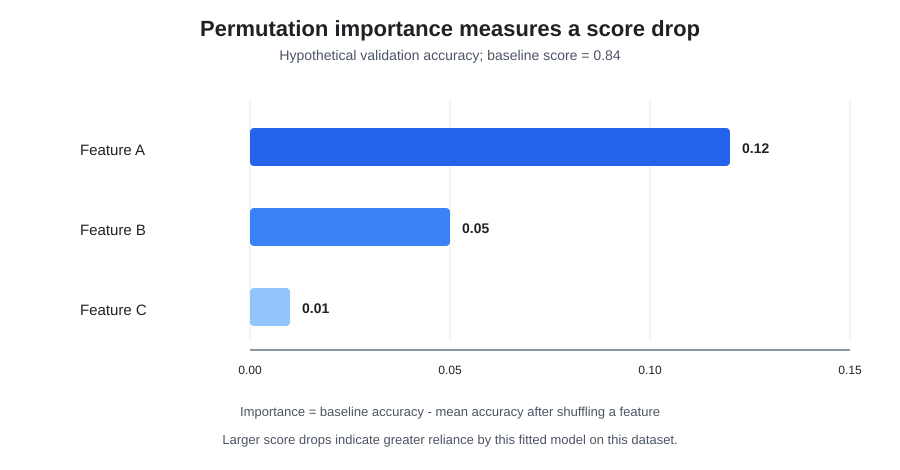
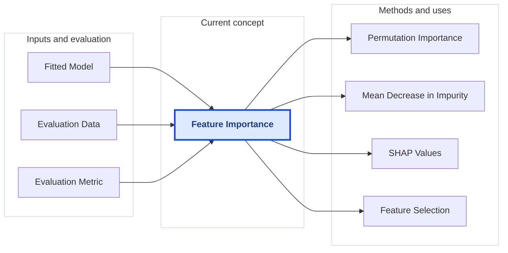

## Definition

Feature importance is a score or ranking used to describe how much a feature matters to a fitted model, according to a specified method. It is not a single, method-independent property: the score can depend on the model, data, evaluation metric, and definition of importance.

Common approaches include permutation importance, which measures a change in model performance after shuffling a feature; mean decrease in impurity (MDI), which sums the impurity reductions attributed to a feature in a fitted tree model; and global summaries of local attributions, such as mean absolute SHAP values [1–3].

## Calculation

For permutation importance, let $s(f,D)$ be a score where larger values are better for model $f$ on dataset $D$. Shuffle feature $j$ independently $K$ times, and let $\tilde{D}_{k,j}$ be the resulting dataset for repeat $k$. Its permutation importance is:

$$
I_j = s(f,D) - \frac{1}{K}\sum_{k=1}^{K}s(f,\tilde{D}_{k,j}).
$$

For example, suppose a model has validation accuracy $0.84$. If shuffling feature A gives a mean accuracy of $0.72$ over repeated shuffles, its estimated importance is $0.84-0.72=0.12$. A drop of $0.05$ for feature B and $0.01$ for feature C gives the illustrative ranking shown below.

Source: Original schematic; the scores and feature names are hypothetical.

The formula uses a higher-is-better score. With a loss where lower is better, importance can instead be expressed as the increase in loss after shuffling. Other methods use different calculations: MDI aggregates split-criterion reductions in trees, while a global SHAP bar summary can rank features by their mean absolute SHAP value across examples [2, 3].

## Interpretation

- A larger permutation score drop means the fitted model's measured performance relies more on that feature on the evaluated dataset, under the selected score.
- Importance scores from different methods or metrics are not necessarily on comparable scales or rankings.
- Global importance summarizes behavior across a dataset and can hide local differences between individual predictions or subgroups.

## Necessity

Feature importance can help inspect which inputs a model relies on, identify unexpected dependencies, compare model behavior, and inform feature-selection investigations. It is most useful when reported with the method, evaluation data, and score that define it [1].

## Limitations and Alternatives

- **It is method-dependent:** Permutation importance, MDI, and SHAP summaries answer different questions; none is a universal ranking [1–3].
- **It is not causal:** A high score does not establish that intervening on a feature would change the outcome.
- **Correlated features can obscure individual importance:** When one correlated feature is shuffled, another may still carry similar information, reducing the measured performance drop for both [1].
- **Tree impurity importance has known biases:** MDI can favor high-cardinality features and may reflect overfitting when calculated on training data [1, 2].
- **Permutation results depend on evaluation choices:** The dataset and scoring metric affect the result. Repeated shuffles show variability, and a held-out dataset or cross-validation helps assess generalization [1].

Alternatives and complementary methods include permutation importance, impurity-based importance, SHAP values, and local feature-attribution methods. Choose the method that matches whether the goal is global ranking, model-performance reliance, or explanation of an individual prediction.

## Derived Subsequent Concepts

- **Permutation Importance:** Estimates reliance on a feature by measuring the score change after its values are shuffled [1].
- **Mean Decrease in Impurity:** Tree-based importance based on the impurity reductions from splits using a feature [1, 2].
- **SHAP Values:** Feature attributions for individual predictions; mean absolute SHAP values can be aggregated into a global feature-importance summary [3]. See [SHAP Values](../S/SHAP%20Values.md).
- **Feature Selection:** The process of choosing a subset of input features for a modeling task; importance scores may inform it, but do not by themselves establish that removing a feature is safe.

The concept map shows the data, model, and evaluation metric that inform feature importance, alongside common methods and uses:

## References

1. Scikit-learn developers. [Permutation feature importance](https://scikit-learn.org/stable/modules/permutation_importance.html).
2. Scikit-learn developers. [Feature importances with a forest of trees](https://scikit-learn.org/stable/auto_examples/ensemble/plot_forest_importances.html).
3. SHAP documentation. [Bar plot: global feature importance from mean absolute SHAP values](https://shap.readthedocs.io/en/latest/example_notebooks/api_examples/plots/bar.html).
