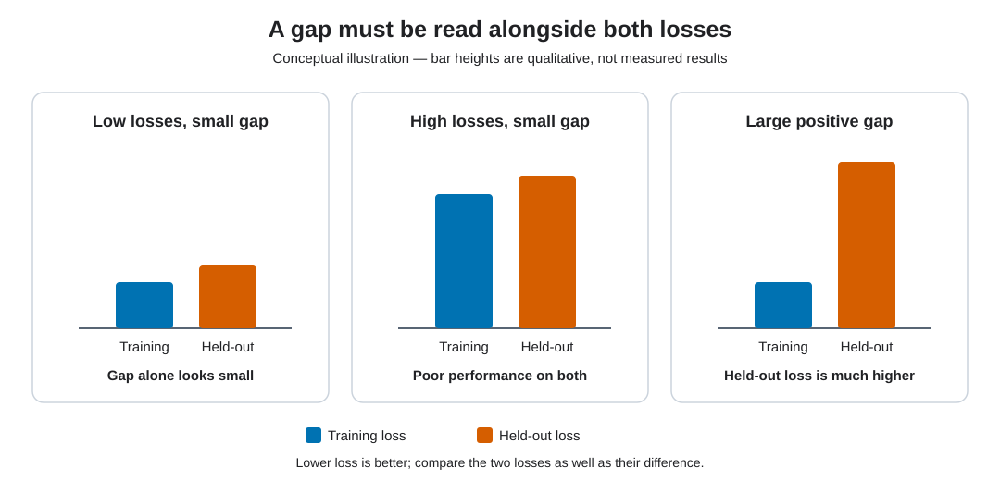

## Definition

The generalization gap is the difference between a model's loss on data used for fitting and its loss on data not used for fitting. In practical evaluation, the second quantity is measured on a held-out validation or test sample; it estimates performance on new observations from the target distribution [1].

In learning theory, the term can refer to the difference between population risk and empirical training risk. A held-out sample provides an estimate of population risk, so a practical train-test gap is itself an estimate rather than the exact population gap [2].

## Calculation

For a loss where smaller values are better, let $D$ be the training sample and $T$ an independent held-out sample of $m$ observations. The empirical gap is:

$$
\widehat{\Delta}_{\text{gen}} = \widehat{R}_{T}(\hat{f}_D) - \widehat{R}_{D}(\hat{f}_D).
$$

Here, $\widehat{R}_{T}$ and $\widehat{R}_{D}$ are the mean losses on the held-out and training samples, respectively. A positive value means the held-out average loss is higher than the training loss. For a score where larger values are better, reverse the subtraction to express the same deterioration as a positive gap. Use the same metric and comparable samples when making the comparison.

Source: Original conceptual illustration for this entry, based on the training-versus-validation comparisons described in [1]. Bar heights are qualitative, not measured results.

## Interpretation

A large positive loss gap can be a warning sign of [overfitting](../O/Overfitting.md), especially when training loss is low. However, the gap must be read alongside both losses: a small gap can describe a model that performs well on both samples or one that performs poorly on both. The gap is a diagnostic comparison, not a complete measure of [generalization](./Generalization.md).

## Necessity

Comparing training and held-out performance helps identify when fitting the training sample is not translating into comparable performance on new data. It can inform model selection and motivate changes such as adjusting model complexity or regularization, but a smaller gap alone does not establish that a model is better. Compare held-out loss and task requirements as well [1].

## Limitations and Alternatives

- **It depends on the metric:** The sign convention differs for losses, where lower is better, and scores, where higher is better. The metric should be stated explicitly.
- **It depends on the data split:** A finite held-out sample can produce a noisy estimate, and the gap can change across splits.
- **It assumes comparable data:** If training and held-out samples come from different distributions, their difference can reflect that shift as well as model fit.
- **It is not a universal threshold:** There is no single gap size that proves overfitting across tasks, datasets, or metrics.
- **Selection can bias the estimate:** Repeatedly choosing models based on the same validation results can overfit that validation sample. Use cross-validation during development and reserve an untouched test set for final evaluation when possible [3].

## Derived Subsequent Concepts

- [**Generalization**](./Generalization.md): The ability to perform usefully on observations not used to fit a model.
- [**Overfitting**](../O/Overfitting.md): A pattern in which training-specific fit does not transfer well to unseen data.
- **Validation loss:** A held-out loss used during model development; repeated tuning against it can make it part of the selection process.
- **Test loss:** A held-out loss used for final evaluation after model choices have been made.

## References

1. Scikit-learn Developers. [Validation curves and learning curves](https://scikit-learn.org/stable/modules/learning_curve.html).
2. Hastie, T., Tibshirani, R., & Friedman, J. (2009). *The Elements of Statistical Learning: Data Mining, Inference, and Prediction* (2nd ed.), Section 7.3. [Springer](https://doi.org/10.1007/978-0-387-84858-7).
3. Cawley, G. C., & Talbot, N. L. C. (2010). [On Over-fitting in Model Selection and Subsequent Selection Bias in Performance Evaluation](https://jmlr.org/papers/v11/cawley10a.html). *Journal of Machine Learning Research*, 11(70), 2079–2107.
