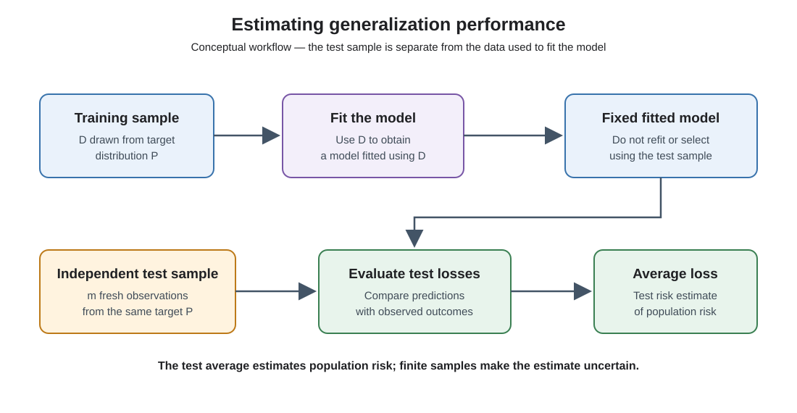

## Definition

Generalization is a fitted model's ability to make useful predictions on observations that were not used to fit it. Its performance depends on the target data distribution and the evaluation metric; strong performance on the training sample alone does not establish that the model generalizes [1].

For a model $\hat{f}_D$ fitted on training data $D$, its population risk is the expected loss on a fresh observation drawn from the target distribution $\mathcal{P}$:

$$
R_{\mathcal{P}}(\hat{f}_D) = \mathbb{E}_{(X,Y)\sim\mathcal{P}}\left[\ell(\hat{f}_D(X),Y)\right].
$$

## Calculation

The population risk is generally unknown. Given an independent test sample of $m$ observations drawn from the same target distribution, estimate it with the average test loss:

$$
\widehat{R}_{\text{test}} = \frac{1}{m}\sum_{i=1}^{m}\ell(\hat{f}_D(x_i),y_i).
$$

The test sample must not have been used to fit or select the model if its score is to provide an independent final evaluation. During model development, use a validation set or cross-validation for model and hyperparameter selection, then reserve a test set for final evaluation when available [1, 2].

Source: Original schematic for this entry, based on the held-out evaluation workflow described in [1].

## Interpretation

A model generalizes well when its chosen performance measure remains useful on new, relevant observations. A low training loss is not sufficient: the model may have fit sample-specific patterns and perform worse on unseen data, a pattern associated with [overfitting](../O/Overfitting.md). Conversely, a model that performs poorly even on its training data may be [underfitting](../U/Underfitting.md).

Generalization is not the same as a small [generalization gap](../O/Overfitting.md), which compares training and unseen-data performance. Both training and test performance can be poor while the gap remains small.

## Necessity

The purpose of evaluating generalization is to estimate how a model will perform beyond the observations used to fit it. Held-out evaluation and cross-validation help compare models using data not used for each fit, while an untouched final test set helps limit selection bias in reported performance [1, 2].

## Limitations and Alternatives

- **Finite-sample uncertainty:** A test score is an estimate based on a limited sample and can vary with the particular split.
- **Distribution dependence:** A test set estimates performance for its source distribution. If deployment data differ, the estimate may not represent deployment performance.
- **Test-set reuse:** Repeatedly choosing models based on test results turns the test set into part of the selection process and can bias the reported score [2].
- **Metric dependence:** Generalization is assessed through a chosen loss or metric; one score does not describe every aspect of model quality.
- **No guarantee for individual cases:** Good average test performance does not ensure accurate predictions for every subgroup or observation.

## Derived Subsequent Concepts

- [**Overfitting**](../O/Overfitting.md): A model fits training-specific details and performs worse on unseen data.
- [**Underfitting**](../U/Underfitting.md): A model fails to capture relevant structure, often performing poorly on training and unseen data.
- [**Bias-Variance Tradeoff**](../B/Bias-Variance%20Tradeoff.md): A framework for understanding components of expected prediction error under squared loss.
- **Generalization Gap:** The difference between training and unseen-data performance; it is a diagnostic comparison, not a complete measure of generalization.

## References

1. Scikit-learn Developers. [Cross-validation: evaluating estimator performance](https://scikit-learn.org/stable/modules/cross_validation.html).
2. Cawley, G. C., & Talbot, N. L. C. (2010). [On Over-fitting in Model Selection and Subsequent Selection Bias in Performance Evaluation](https://jmlr.org/papers/v11/cawley10a.html). *Journal of Machine Learning Research*, 11(70), 2079–2107.
