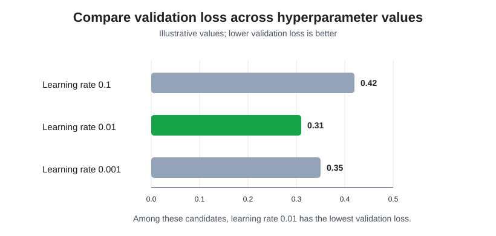
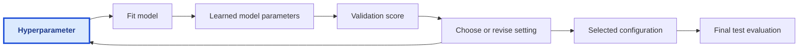

## Definition

A hyperparameter is a setting that controls an estimator or its training procedure but is not directly learned as part of fitting that estimator. Examples include a learning rate, a regularization strength, or the maximum depth of a decision tree. Hyperparameters are commonly selected by comparing candidate settings using validation data or cross-validation [1].

Model parameters, by contrast, are values estimated from training data during fitting, such as the coefficients of a linear model.

## Calculation

Hyperparameter selection can be represented as a two-stage optimization. For model parameters $\mathbf{w}$ and hyperparameters $\boldsymbol{\lambda}$:

$$
\mathbf{w}^*(\boldsymbol{\lambda})
=
\arg\min_{\mathbf{w}}
\mathcal{L}_{\text{train}}(\mathbf{w};\boldsymbol{\lambda}),
\qquad
\boldsymbol{\lambda}^*
=
\arg\min_{\boldsymbol{\lambda}\in\Lambda}
\widehat{\mathcal{L}}_{\text{validation}}
\left(\mathbf{w}^*(\boldsymbol{\lambda})\right),
$$

where fitting estimates model parameters for a chosen hyperparameter setting, and validation performance guides the choice among settings in the search space $\Lambda$. In practice, the search may use a grid, random sampling, or another strategy [1].

For example, suppose three learning rates are compared using the same validation split:

| Learning rate | Validation loss |
|---:|---:|
| 0.1 | 0.42 |
| 0.01 | 0.31 |
| 0.001 | 0.35 |

If lower validation loss is the selection criterion, the value $0.01$ is preferred among these three candidates in this illustrative example.

Source: Original chart of the hypothetical values in the table; these are not results from an actual model.

## Interpretation

- A hyperparameter controls how a model is fitted or structured; it is not itself a learned model parameter in the usual fitting procedure.
- A setting does not have a universally good value. Its effect depends on the model, data, training procedure, and evaluation criterion.
- The selected value is the best among the candidates and evaluation procedure used; it is not necessarily the global optimum.

## Necessity

Hyperparameters can affect model capacity, optimization, regularization, and computational cost. Comparing candidate values with validation data or cross-validation helps choose settings for a task without using the final test set for repeated tuning [1, 2].

## Limitations and Alternatives

- **Search can be expensive:** A large search space or costly training procedure can require substantial computation [1].
- **Selection can overfit validation data:** Repeatedly choosing settings based on the same validation results can bias those results; reserve a test set for a final evaluation [2].
- **Search results depend on the search space and metric:** A search cannot select settings it never considers, and the chosen score may not capture every practical requirement.
- **Not all settings are static:** A hyperparameter such as a learning rate may be adjusted by a schedule during training; the schedule and its configuration are still chosen as part of the training setup.

## Derived Subsequent Concepts

- [**Experiment Tracking**](../E/Experiment%20Tracking.md): Records the hyperparameter settings and outcomes of training runs for comparison.
- [**Generalization**](../G/Generalization.md): The ability to perform usefully on observations not used to fit a model.
- **Model Parameter:** A value estimated from training data during model fitting.
- **Model Selection:** Choosing a model or configuration using an evaluation procedure.
- **Cross-validation:** A procedure for evaluating candidate settings across multiple training and validation splits [1].

The concept map shows that hyperparameters configure each fit, while validation results guide the search and a separate test set is reserved for final evaluation:

## References

1. Scikit-learn Developers. [Tuning the hyper-parameters of an estimator](https://scikit-learn.org/stable/modules/grid_search.html).
2. Cawley, G. C., & Talbot, N. L. C. (2010). [On Over-fitting in Model Selection and Subsequent Selection Bias in Performance Evaluation](https://jmlr.org/papers/v11/cawley10a.html). *Journal of Machine Learning Research*, 11(70), 2079–2107.
