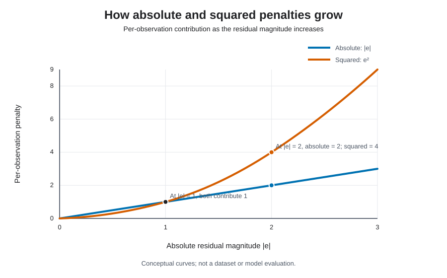

## Definition

Mean absolute error (MAE) is the arithmetic mean of the absolute differences between observed target values and predictions. It is a nonnegative regression loss and evaluation metric; zero is the best possible value [1].

## Calculation

For $n$ observations, let $y_i$ be the observed value, $\hat{y}_i$ its prediction, and $e_i=y_i-\hat{y}_i$ the residual. Then:

$$
\text{MAE} = \frac{1}{n}\sum_{i=1}^{n}|e_i|
=\frac{1}{n}\sum_{i=1}^{n}|y_i-\hat{y}_i|.
$$

Using the scikit-learn example also used for [MSE](./Mean%20Squared%20Error.md), the observed values are $[3,-0.5,2,7]$ and the predictions are $[2.5,0,2,8]$ [1]. The absolute residuals are $[0.5,0.5,0,1]$, so:

$$
\text{MAE} = \frac{0.5+0.5+0+1}{4} = 0.5.
$$

MAE is $0.5$ in the target's units.

Source: Original conceptual plot of the absolute-error and squared-error penalty functions.

## Interpretation

MAE averages error magnitudes without allowing positive and negative residuals to cancel. Each additional unit of absolute residual adds the same amount to its per-observation contribution. For comparison, MSE squares residuals: an error magnitude of $4$ contributes $4$ to absolute error but $16$ to squared error, while an error magnitude of $1$ contributes $1$ to both [1, 2].

MAE uses the target's original units. It is less dominated by a few large errors than squared-error measures, but it is not immune to outliers: a large residual still increases the average in proportion to its size.

## Necessity

MAE is useful when a linear penalty per unit of prediction error is meaningful, and a few large residuals should not receive the extra quadratic weight they receive under MSE or [RMSE](../R/Root%20Mean%20Squared%20Error.md). It can be easier to explain as an average absolute error in the target's units.

## Limitations and Alternatives

- **Scale-dependent:** MAE has the target's units, so its values are not generally comparable across targets with different units or scales.
- **Outliers still matter:** MAE reduces the disproportionate influence caused by squaring, but extreme residuals still contribute more than small ones.
- **It does not show error direction:** Taking absolute values discards whether predictions are above or below the observed targets; inspect signed residuals as well when bias matters.
- **Metric choice changes the penalty:** [MSE](./Mean%20Squared%20Error.md) and [RMSE](../R/Root%20Mean%20Squared%20Error.md) place greater relative weight on large errors. [Regression Metrics](../R/Regression%20Metrics.md) compares these measures.

## Derived Subsequent Concepts

- [**Mean Squared Error (MSE)**](../M/Mean%20Squared%20Error.md): A squared-error alternative that penalizes large residuals more strongly.
- [**Root Mean Squared Error (RMSE)**](../R/Root%20Mean%20Squared%20Error.md): A target-unit metric that retains squared-error sensitivity.
- [**Regression Metrics**](../R/Regression%20Metrics.md): Compares MAE with other regression measures.
- [**Regression**](../R/Regression.md): The quantitative prediction task MAE can evaluate.

## References

1. Scikit-learn Developers. [mean_absolute_error documentation](https://scikit-learn.org/stable/modules/generated/sklearn.metrics.mean_absolute_error.html).
2. Scikit-learn Developers. [Regression metrics](https://scikit-learn.org/stable/modules/model_evaluation.html#regression-metrics).
