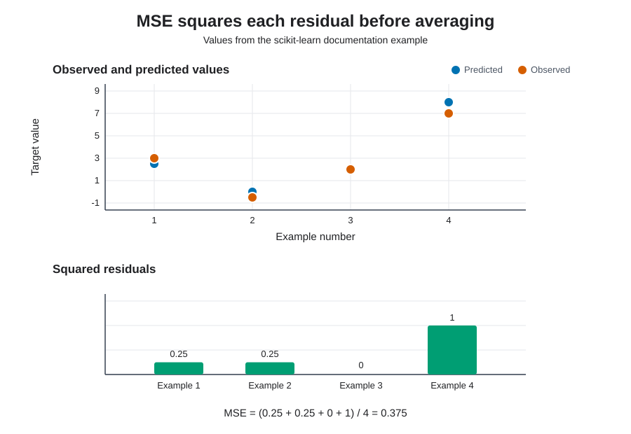

## Definition

Mean squared error (MSE) is the arithmetic mean of the squared differences between observed target values and predictions. It is a common loss function and evaluation metric for regression [1].

## Calculation

For $n$ observations, let $y_i$ be the observed value and $\hat{y}_i$ its prediction. The residual is $e_i=y_i-\hat{y}_i$, and:

$$
\text{MSE} = \frac{1}{n}\sum_{i=1}^{n}e_i^2
=\frac{1}{n}\sum_{i=1}^{n}(y_i-\hat{y}_i)^2.
$$

For example, scikit-learn documents the observed values $[3,-0.5,2,7]$ and predictions $[2.5,0,2,8]$ [1]. Their residuals are $[0.5,-0.5,0,-1]$, so:

$$
\text{MSE}
=\frac{0.5^2+(-0.5)^2+0^2+(-1)^2}{4}
=\frac{1.5}{4}
=0.375.
$$

The value is $0.375$ in squared target units.

Source: Original schematic of the example values documented by scikit-learn [1].

## Interpretation

MSE is nonnegative, and it is zero when every prediction equals its observed target. Squaring makes larger residuals contribute disproportionately: a residual of magnitude $4$ contributes $16$, while a residual of magnitude $1$ contributes $1$. Thus, MSE is especially sensitive to large errors [1].

Because the errors are squared, MSE is expressed in squared target units. Its magnitude is therefore less directly interpretable than the [root mean squared error (RMSE)](../R/Root%20Mean%20Squared%20Error.md), which takes the square root.

## Necessity

MSE provides a single score that penalizes large prediction errors strongly. It is useful when large errors should carry substantially more cost than small ones, and it is widely used as an objective for fitting regression models [1, 2].

## Limitations and Alternatives

- **Sensitivity to outliers:** A few large residuals can dominate the mean squared error, whether those observations are unusual, erroneous, or genuinely costly.
- **Squared units:** The score does not use the target's original units, which can make its size harder to explain.
- **Scale dependence:** MSE values are not generally comparable across targets with different units or scales.
- **Alternatives express different priorities:** [Mean Absolute Error (MAE)](./Mean%20Absolute%20Error.md) penalizes error magnitude linearly; [RMSE](../R/Root%20Mean%20Squared%20Error.md) is in target units but retains squared-error sensitivity.
- **The average hides individual errors:** Report or inspect residuals when large errors or systematic patterns matter.

## Derived Subsequent Concepts

- [**Regression Metrics**](../R/Regression%20Metrics.md): Compares MSE with other measures of regression performance.
- [**Regression**](../R/Regression.md): The quantitative prediction task in which MSE is often used.
- [**Root Mean Squared Error (RMSE)**](../R/Root%20Mean%20Squared%20Error.md): Expresses the square root of MSE in the target's units.
- [**Mean Absolute Error (MAE)**](./Mean%20Absolute%20Error.md): A linear-in-error alternative to MSE.

## References

1. Scikit-learn Developers. [mean_squared_error documentation](https://scikit-learn.org/stable/modules/generated/sklearn.metrics.mean_squared_error.html).
2. National Institute of Standards and Technology. [Linear Least Squares Regression](https://www.itl.nist.gov/div898/handbook/pmd/section1/pmd141.htm).
