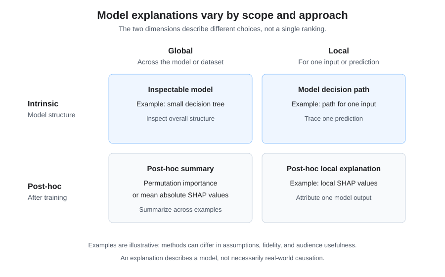
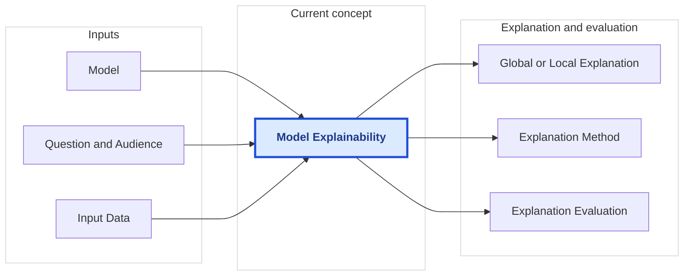

## Definition

Model explainability concerns producing and evaluating explanations that help people understand a model's behavior or a particular prediction. The terms *explainability* and *interpretability* are used inconsistently in the literature; this entry uses *model explainability* as a broad term for methods and evaluations that make relevant model behavior understandable in context [1, 2].

An explanation is not a property of a model alone. Its usefulness depends on what someone needs to understand, who will use it, and how the explanation represents the model [1, 2].

## Calculation

There is no single formula or score for model explainability. Methods can instead be described along two independent axes:

| Axis | Common categories | Question |
| --- | --- | --- |
| **Scope** | Global or local | Does the explanation describe overall model behavior or one prediction? |
| **Approach** | Intrinsic or post-hoc | Is the model itself designed to be understandable, or is an explanation generated after the model is trained? |

For example, a small decision tree can expose global structure intrinsically and provide a decision path for one input. A permutation-importance or mean absolute SHAP summary can describe behavior across a dataset, while a local SHAP explanation can describe attributions for one prediction [1]. These are examples rather than an exhaustive or exclusive classification.

To select and assess an explanation, first specify the question and intended audience, then choose its scope and method. Evaluate whether it represents the model behavior relevant to that question and whether the intended audience can use it; producing an explanation alone does not establish either quality [1, 2].

## Interpretation

- **Global explanations** summarize patterns or structure across a model or dataset; **local explanations** concern a particular input or prediction.
- **Intrinsic approaches** use a model whose structure is directly inspectable for the task; **post-hoc approaches** analyze an already-trained model.
- These axes are independent: global and local explanations can each be intrinsic or post-hoc.
- The explanation answers a defined question about a model. It does not automatically explain the real-world causes of an outcome.

## Necessity

Explanations can help investigate unexpected predictions, debug models, communicate model behavior, and support audits or scientific inquiry. They are especially relevant when a prediction alone does not answer the practical question that motivated the system [1, 2].

## Limitations and Alternatives

- **No universally agreed definition or evaluation:** Explainability and interpretability are used differently across sources, and the evaluation should match the question, audience, and task [1, 2].
- **An explanation can be incomplete or misleading:** A readable account is not necessarily a faithful account of the model, and a faithful technical result may still be difficult for its intended audience to use.
- **Post-hoc explanations are not the model itself:** Their scope and assumptions matter; different methods can describe different aspects of the same model [1].
- **Explanation does not establish causality:** A model attribution or feature ranking does not show that changing a real-world factor would cause the predicted change.
- **Explainability is not a fairness or correctness guarantee:** [Algorithmic Fairness](../A/Algorithmic%20Fairness.md) and predictive performance require their own context-specific evaluation.

Depending on the question, alternatives or complements include intrinsically interpretable models, [Feature Importance](../F/Feature%20Importance.md), [SHAP Values](../S/SHAP%20Values.md), and counterfactual explanations.

## Derived Subsequent Concepts

- **Global Explanation:** A summary of patterns or behavior across a model or dataset.
- **Local Explanation:** An account of one model output for a particular input.
- **Feature Attribution:** Assigning contributions to input features for a model output; [SHAP Values](../S/SHAP%20Values.md) are one approach.
- **Feature Importance:** A family of measures used to summarize model reliance or feature relevance; see [Feature Importance](../F/Feature%20Importance.md).
- **Model Audit:** A systematic review of a model's behavior, performance, and risks in a specified context.

The concept map shows the model and the question being asked as inputs to explainability, which then guides the choice and evaluation of an explanation:

## References

1. Molnar, C. [Interpretable Machine Learning, Chapter 2: Interpretability](https://christophm.github.io/interpretable-ml-book/interpretability.html).
2. Doshi-Velez, F., & Kim, B. (2017). [Towards A Rigorous Science of Interpretable Machine Learning](https://arxiv.org/abs/1702.08608). arXiv:1702.08608.
