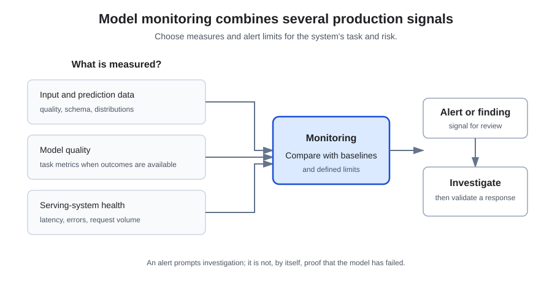
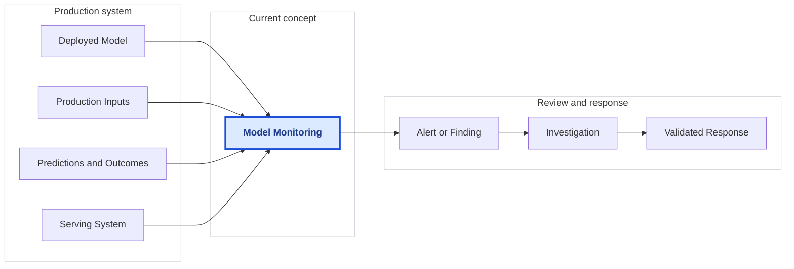

## Definition

Model monitoring is the ongoing measurement and review of a deployed machine-learning system to check whether it continues to behave and perform within defined expectations. It can cover the model, its inputs and outputs, and the software system that serves predictions [1, 2].

Monitoring is a process, not a single metric. Depending on the task and risk, teams may track input data quality and distributions, prediction patterns, model quality when reference outcomes become available, operational signals such as latency and errors, and relevant subgroup outcomes [1, 2].

## Calculation

There is no universal model-monitoring score. Teams select metrics and acceptable limits that match the system's purpose, establish a baseline, and assess production measurements over time [1].

For a higher-is-better quality metric $q$, a simple baseline comparison is:

$$
\Delta_t = q_{\text{baseline}} - q_t,
\qquad
\text{investigate if } \Delta_t > \tau,
$$

where $q_t$ is the metric on a recent evaluation window and $\tau$ is a task-specific alert threshold. For example, if baseline F1 is $0.90$, recent F1 on labeled production examples is $0.83$, and a team-defined alert threshold is $0.05$, the $0.07$ drop triggers investigation. This is an illustrative rule, not a universal threshold. Metrics where lower values are better, such as error or latency, require the comparison to be oriented accordingly.

Source: Original schematic based on the monitoring goals described by NIST and the ML Test Score [1, 2].

## Interpretation

- **Operational monitoring** tracks whether the serving system is functioning, for example request volume, latency, and errors.
- **Data and prediction monitoring** checks input quality and changes in feature or prediction distributions.
- **Quality monitoring** evaluates task metrics against known outcomes when labels or other reference results are available; such feedback can be delayed.
- **Risk monitoring** may include subgroup performance, user feedback, and other use-context measures relevant to the system [1].

**Model drift** is one kind of change that monitoring may investigate, not a synonym for model monitoring. A detected distribution change is a signal to assess; it does not by itself prove that model quality has declined [1].

## Necessity

Offline evaluation cannot guarantee that a model will remain suitable as data, software dependencies, and use conditions change. Monitoring can reveal operational failures, data-quality problems, training-serving differences, or changes in measured outcomes, so teams can investigate and respond [1, 2].

## Limitations and Alternatives

- **Labels may arrive late or be unavailable:** Without suitable reference outcomes, direct measures of predictive quality may not be computable for the newest predictions. Proxy signals cannot fully replace labeled evaluation.
- **A change is not automatically a failure:** Input or prediction distributions may change without harming the intended task, while harmful failures may occur without a simple distribution shift. Investigate signals in context rather than treating every alert as proof of degradation [1].
- **Baselines and thresholds need review:** A baseline from one period or population may become inappropriate; chosen metrics may also fail to capture important outcomes or affected groups [1].
- **Monitoring is not remediation:** Alerts identify conditions for review. Retraining, rollback, or threshold changes should follow investigation and validation, not be automatic responses to every signal.
- **Aggregate metrics can hide local problems:** Overall performance can obscure subgroup failures or rare but consequential cases; choose disaggregated measures when justified by the task and risk [1].

## Derived Subsequent Concepts

- **Data Drift:** A change in the distribution of input data relative to a reference distribution; it is one signal a monitoring process may track [1].
- **Model Performance Monitoring:** Tracking task-relevant quality measures, often using outcomes collected after predictions are made.
- **Training-Serving Skew:** Differences between the data or feature processing used for training and those used to serve predictions [2].
- **Model Incident Response:** Investigating alerts and deciding whether to repair, roll back, retrain, or otherwise change the deployed system.

The concept map shows a deployed model and its production signals flowing into monitoring, which informs investigation and response:

## References

1. National Institute of Standards and Technology. [AI Risk Management Framework Playbook: Measure](https://airc.nist.gov/airmf-resources/playbook/measure/).
2. Breck, E., Cai, S., Nielsen, E., Salib, M., & Sculley, D. (2017). [The ML Test Score: A Rubric for ML Production Readiness and Technical Debt Reduction](https://research.google/pubs/the-ml-test-score-a-rubric-for-ml-production-readiness-and-technical-debt-reduction/). *Proceedings of IEEE Big Data*.
