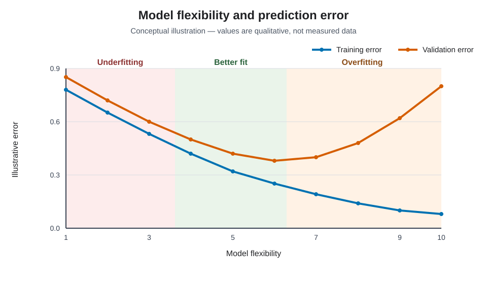

## Definition

Overfitting occurs when a model fits details specific to its training sample, including noise, and consequently performs worse on new data from the intended task. A common warning sign is low training loss combined with substantially higher validation loss [1].

Overfitting is about generalization, not simply about using a complex model. Model flexibility can make fitting sample-specific details easier, but the outcome also depends on the data, the learning procedure, and other constraints [1, 2].

## Calculation

For a loss where smaller values are better, one diagnostic is the [difference between validation and training loss](../G/Generalization%20Gap.md):

$$
\widehat{\Delta}_{\text{generalization}} = \widehat{R}_{\text{validation}} - \widehat{R}_{\text{training}}.
$$

A large positive gap, especially when training loss is low, can indicate overfitting. There is no universal threshold: assess both losses against a baseline and the task's requirements, using the same loss and comparable evaluation data. In polynomial regression, for example, a very high-degree fit can follow training noise and have much worse cross-validated error than a better-chosen degree [1].

## Interpretation

As model flexibility increases, training loss may continue to decrease even after validation loss begins to rise. At that point, the model is learning patterns that help fit its training observations but do not help predict new observations. The conceptual error-versus-flexibility chart in the [Underfitting article](../U/Underfitting.md) illustrates this pattern.

Overfitting is often associated with high variance in the [bias-variance tradeoff](../B/Bias-Variance%20Tradeoff.md), but a train-validation gap from one split is not itself a direct estimate of the formal variance component [2].

*Source: Original schematic created for the [Underfitting entry](../U/Underfitting.md); curves are qualitative, not measured data, and are based on Hastie et al. [2].*

## Necessity

Detecting overfitting helps choose interventions that improve performance on unseen data rather than only training fit. Depending on the cause, options include limiting model complexity, collecting more representative training data, or using regularization. [L1 regularization](../L/L1%20Regularization.md) and [L2 regularization](../L/L2%20Regularization.md) constrain parameter values; [Dropout](../D/Dropout.md) is a stochastic regularization technique for neural networks. Evaluate any intervention on held-out data or with cross-validation; none guarantees improved performance for every task.

## Limitations and Alternatives

- **A gap is not proof by itself:** A small validation sample or a difference between training and validation data distributions can also produce a large gap.
- **Training and validation losses need context:** They should use comparable data and the same metric; a high loss on both sets may instead indicate underfitting or a difficult task.
- **Repeated validation tuning can overfit the validation set:** Repeatedly selecting models against the same finite validation sample can bias the selected performance estimate. Reserve a separate test set for final evaluation when possible [3].
- **Complexity is not the only cause:** Feature choices, data quality, optimization, and evaluation design can all affect observed generalization.

## Derived Subsequent Concepts

- [**Underfitting**](../U/Underfitting.md): A model fails to capture relevant structure and performs poorly even on its training data.
- [**Bias-Variance Tradeoff**](../B/Bias-Variance%20Tradeoff.md): A framework for understanding systematic prediction error and sensitivity to the training sample.
- [**Generalization Gap**](../G/Generalization%20Gap.md): The difference between performance on unseen data and training data; it is a diagnostic quantity, not a complete explanation of model behavior.
- **Regularization:** A family of techniques, including L1, L2, and dropout, that can constrain fitting.

## References

1. Scikit-learn Developers. [Underfitting vs. Overfitting](https://scikit-learn.org/stable/auto_examples/model_selection/plot_underfitting_overfitting.html).
2. Hastie, T., Tibshirani, R., & Friedman, J. (2009). *The Elements of Statistical Learning: Data Mining, Inference, and Prediction* (2nd ed.), Section 7.3. [Springer](https://doi.org/10.1007/978-0-387-84858-7).
3. Cawley, G. C., & Talbot, N. L. C. (2010). [On Over-fitting in Model Selection and Subsequent Selection Bias in Performance Evaluation](https://jmlr.org/papers/v11/cawley10a.html). *Journal of Machine Learning Research*, 11(70), 2079–2107.
