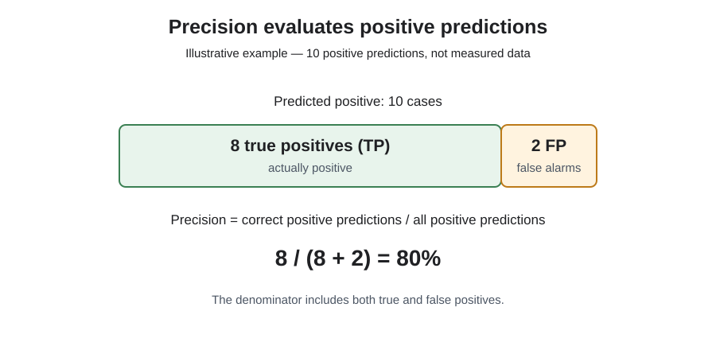

## Definition

Precision, also called positive predictive value, is the fraction of a classifier's positive predictions that are truly positive. It measures how often a positive prediction is correct [1, 2].

## Calculation

For binary classification, let $TP$ be true positives and $FP$ be false positives. Precision is:

$$
\text{Precision} = \frac{TP}{TP+FP}.
$$

For example, if a classifier predicts 10 cases as positive and 8 are truly positive, its precision is $8/(8+2)=0.8$, or 80%.

Source: Original constructed example, based on the precision definition in Google ML Crash Course [1] and scikit-learn [2]; values are illustrative, not measured data.

## Interpretation

Precision answers: “Of the cases the classifier labeled positive, what fraction were actually positive?” In the [confusion matrix](../C/Confusion%20Matrix.md) convention used here, its denominator is the predicted-positive column, $TP+FP$.

Higher precision means fewer false positives among positive predictions. It can be important when false alarms trigger costly follow-up, such as sending legitimate email to a spam folder [1].

## Necessity

Precision is useful when the reliability of positive predictions matters. It should be considered alongside [recall](../C/Classification%20Metrics.md), which measures how many actual positives were found; a classifier can have high precision while missing many positive cases.

## Limitations and Alternatives

- **It does not measure missed positives:** Precision does not directly account for false negatives or true negatives.
- **It depends on the threshold:** Changing the classification threshold changes which cases are predicted positive and can change precision [1].
- **It depends on positive-class prevalence:** Precision can differ between populations with different positive-class frequencies, even when the classifier's behavior is otherwise similar [1].
- **It can be undefined:** If the classifier predicts no positive cases, $TP+FP=0$. Metric implementations may use different documented conventions for this case [2].
- **It is sample-dependent:** With few positive predictions, a small number of cases can substantially change the estimate.
- **Multiclass averaging must be stated:** Precision can be calculated per class and aggregated in different ways; report the averaging method [2].

## Derived Subsequent Concepts

- [**Classification Metrics**](../C/Classification%20Metrics.md): Places precision alongside accuracy, recall, F1, and other measures.
- [**Confusion Matrix**](../C/Confusion%20Matrix.md): Supplies the TP and FP counts used in precision.
- **Recall:** The fraction of actual positives that are correctly identified.
- **F1 Score:** A harmonic-mean summary of precision and recall.
- **Classification Threshold:** A score cutoff that affects the set of positive predictions.
- [**Class Imbalance**](../C/Class%20Imbalance.md): A difference in class frequencies that can affect interpretation of precision.

## References

1. Google for Developers. [Classification: Accuracy, recall, precision, and related metrics](https://developers.google.com/machine-learning/crash-course/classification/accuracy-precision-recall).
2. Scikit-learn Developers. [precision_score documentation](https://scikit-learn.org/stable/modules/generated/sklearn.metrics.precision_score.html).
