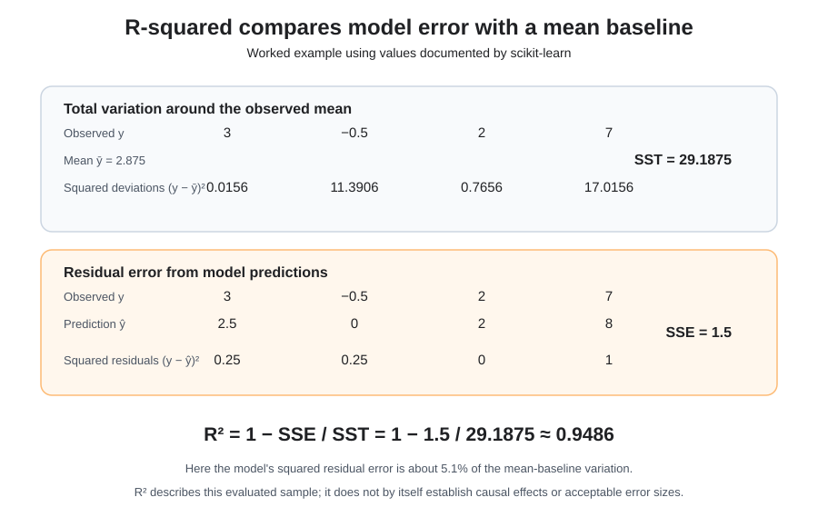
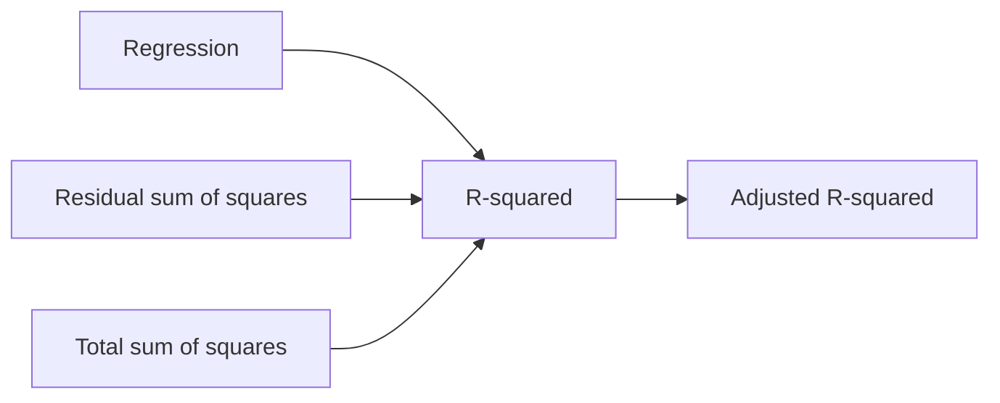

## Definition

R-squared ($R^2$), also called the coefficient of determination, is a score that compares a model's residual error with the variation of observed target values around their mean [1].

## Calculation

For $n$ observed values $y_i$ and predictions $\hat{y}_i$, the common nonconstant-target definition is:

$$
R^2 =
1 -
\frac{\sum_{i=1}^{n}(y_i-\hat{y}_i)^2}
{\sum_{i=1}^{n}(y_i-\bar{y})^2},
$$

where $\bar{y}$ is the mean of the observed targets. The numerator is the residual sum of squares; the denominator is the total sum of squares around that mean [1].

Using the scikit-learn example also used for [MSE](../M/Mean%20Squared%20Error.md), let $y=[3,-0.5,2,7]$ and $\hat{y}=[2.5,0,2,8]$ [1]. Here $\bar{y}=2.875$, the residual sum of squares is $1.5$, and the total sum of squares is $29.1875$. Therefore:

$$
R^2 = 1-\frac{1.5}{29.1875}\approx0.9486.
$$

Source: Original schematic of the example values documented by scikit-learn [1].

## Interpretation

- $R^2=1$ indicates perfect predictions for the evaluated observations.
- $R^2=0$ means the model's sum of squared residuals equals that of the constant baseline that predicts the observed mean.
- $R^2<0$ means the model has greater squared error than that mean baseline. For example, with $y=[1,2,3]$ and predictions $[3,2,1]$, the score is $1-8/2=-3$ [1].

For nonconstant targets, ordinary least squares evaluated on its fitting data with an intercept has $R^2$ between $0$ and $1$. For general prediction models or held-out data, it can be negative, so it is not universally restricted to that interval [1, 2].

## Necessity

$R^2$ provides a dimensionless comparison with a mean-prediction baseline, which can summarize relative fit without using the target's units. It is often reported alongside error measures such as [MSE](../M/Mean%20Squared%20Error.md), [RMSE](./Root%20Mean%20Squared%20Error.md), or [MAE](../M/Mean%20Absolute%20Error.md), which describe error magnitude on different scales [1].

## Limitations and Alternatives

- **It does not establish practical accuracy:** A high $R^2$ does not reveal the size or cost of individual errors; inspect error metrics and residuals as well.
- **It is not a causal measure:** A high score does not show that the input features cause changes in the target.
- **It can be negative:** For models not fitted by ordinary least squares on the evaluation data, predictions can perform worse than the mean baseline [1].
- **It is undefined for constant targets under the usual formula:** The denominator is zero if all observed targets are identical. Software may handle this edge case using a convention rather than returning the mathematical undefined value [1].
- **It is not adjusted for model size:** For nested OLS models with an intercept evaluated on the same training data, $R^2$ cannot decrease when predictors are added. [Adjusted R-squared](./Regression%20Metrics.md) applies a model-size adjustment, but is not a replacement for held-out evaluation.
- **It can hide different data patterns:** Similar summary scores do not guarantee similar relationships, as shown by [Anscombe's quartet](./Regression.md).

## Derived Subsequent Concepts

- [**Regression Metrics**](./Regression%20Metrics.md): Compares $R^2$ with absolute- and squared-error measures.
- [**Mean Squared Error (MSE)**](../M/Mean%20Squared%20Error.md): A squared-error metric used in the numerator of the common $R^2$ formula.
- [**Regression**](./Regression.md): The quantitative prediction task in which $R^2$ is commonly used.
- [**Adjusted R-squared**](../A/Adjusted%20R-squared.md): A related statistic that accounts for the number of predictors in a fitted regression model.

The diagram summarizes the concepts that feed into the common $R^2$ definition and the statistic derived from it:

## References

1. Scikit-learn Developers. [r2_score documentation](https://scikit-learn.org/stable/modules/generated/sklearn.metrics.r2_score.html).
2. National Institute of Standards and Technology. [Linear Least Squares Regression](https://www.itl.nist.gov/div898/handbook/pmd/section1/pmd141.htm).
