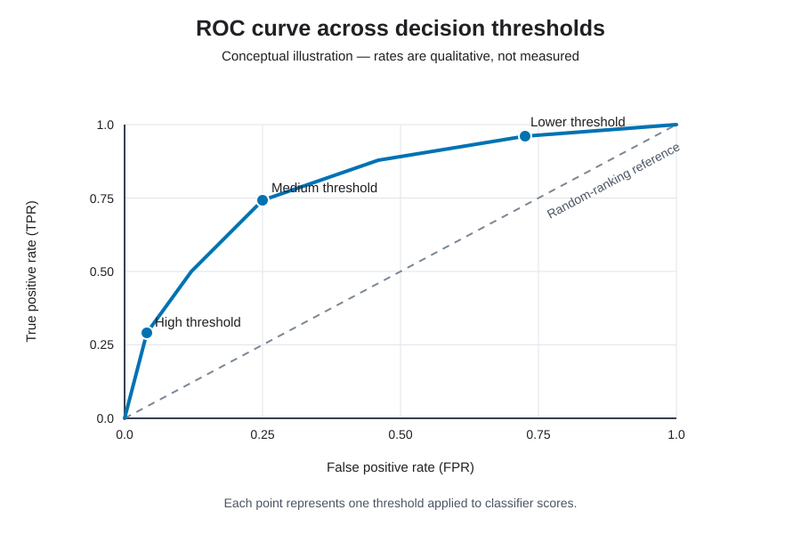

## Definition

A receiver operating characteristic (ROC) curve is a plot of the true positive rate (TPR) against the false positive rate (FPR) for different decision thresholds of a binary classifier. Each threshold applied to the classifier's scores yields an operating point on the curve [1, 2].

## Calculation

For each threshold $t$, classify a case as positive when its score meets the threshold, then compute:

$$
\text{TPR}(t) = \frac{TP(t)}{TP(t)+FN(t)},
\qquad
\text{FPR}(t) = \frac{FP(t)}{FP(t)+TN(t)}.
$$

Plot $\text{FPR}(t)$ on the horizontal axis and $\text{TPR}(t)$ on the vertical axis as $t$ varies. The area under this curve is [ROC-AUC](./ROC-AUC.md), a summary measure across thresholds [1].

Source: Original qualitative schematic based on the ROC definition and threshold behavior in scikit-learn [1, 2]; the curve is not measured data.

## Interpretation

The ROC curve shows how the true-positive and false-positive rates change together as the decision threshold changes. A point closer to the upper-left corner has a higher TPR and lower FPR. The diagonal is a reference for random ranking; it is not a threshold recommended for a particular application [2].

The curve summarizes possible operating points but does not choose one. Threshold selection depends on the costs of false positives and false negatives and on the requirements of the task.

## Necessity

Examining the ROC curve can help compare binary classifiers across thresholds rather than at only one default cutoff. It also makes the tradeoff between detecting positives and producing false alarms explicit [1, 2].

## Limitations and Alternatives

- **It does not specify a threshold:** A curve or its area does not identify a decision rule that meets a particular cost or service requirement.
- **It depends on score ordering:** The curve is formed from classifier scores; using only hard class labels yields just one operating point.
- **It is usually a binary-class view:** Multiclass ROC analysis requires a defined binarization and averaging approach; available implementations differ [1, 2].
- **It does not directly show precision:** The FPR denominator is the number of actual negatives. When positive examples are rare, also inspect precision-recall behavior to understand the correctness of positive predictions [3].
- **It is sample-dependent:** Estimated rates and curve shape can vary with the evaluation sample, especially when there are few examples of a class.

## Derived Subsequent Concepts

- [**Recall**](./Recall.md): The true positive rate plotted on the ROC curve.
- [**Confusion Matrix**](../C/Confusion%20Matrix.md): Supplies the TP, FN, FP, and TN counts used to compute each operating point.
- [**Classification Metrics**](../C/Classification%20Metrics.md): Describes ROC-AUC among other classification measures.
- [**ROC-AUC**](./ROC-AUC.md): The area under the ROC curve, which summarizes ranking performance across thresholds.
- **Classification Threshold:** The score cutoff that selects an operating point on the curve.

## References

1. Scikit-learn Developers. [roc_curve documentation](https://scikit-learn.org/stable/modules/generated/sklearn.metrics.roc_curve.html).
2. Scikit-learn Developers. [Multiclass Receiver Operating Characteristic (ROC)](https://scikit-learn.org/stable/auto_examples/model_selection/plot_roc.html).
3. Scikit-learn Developers. [Precision-Recall](https://scikit-learn.org/stable/auto_examples/model_selection/plot_precision_recall.html).
