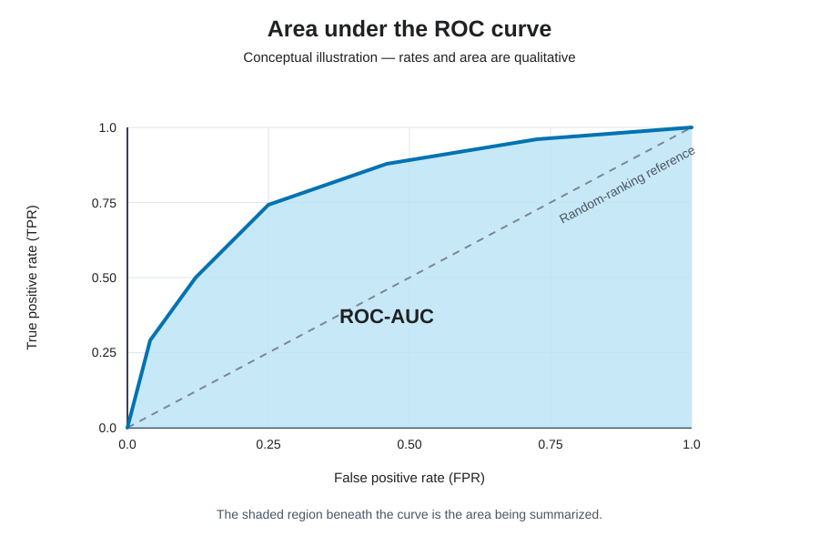

## Definition

The area under the receiver operating characteristic curve (ROC-AUC, also called ROC AUC) is the area beneath a classifier's [ROC curve](./ROC%20Curve.md), which plots true positive rate against false positive rate as the decision threshold varies [1, 2].

## Calculation

For a binary classifier, let $\text{TPR}(u)$ be the true positive rate at false positive rate $u$. The ROC-AUC is the integral:

$$
\text{ROC-AUC} = \int_0^1 \text{TPR}(u)\,du.
$$

Given a finite set of scored examples, the ROC curve consists of discrete operating points. Implementations commonly compute the area by trapezoidal integration between those points [1].

Source: Original qualitative schematic based on the ROC-AUC definition and interpretation in Google for Developers [2]; the curve is not measured data.

## Interpretation

ROC-AUC summarizes ranking discrimination across thresholds. Under the standard binary interpretation, it is the probability that a randomly selected positive example receives a higher score than a randomly selected negative example; tied scores are conventionally treated as half a correct ordering [2, 3].

An ROC-AUC of $1$ indicates perfect ranking, while $0.5$ corresponds to the random-ranking diagonal. A value below $0.5$ can indicate that the ranking direction is reversed, depending on which class is treated as positive and how scores are oriented [2].

## Necessity

ROC-AUC is useful for comparing binary classifiers by their score rankings without choosing one decision threshold first. It complements threshold-specific measures such as [precision](../P/Precision.md), [recall](./Recall.md), and accuracy, which describe predictions at a selected threshold [1, 2].

## Limitations and Alternatives

- **It does not select a threshold:** A high ROC-AUC does not identify a threshold that meets the application's error costs or operating requirements.
- **It does not measure calibration:** Two models can rank examples similarly while assigning different probability values; ROC-AUC alone does not assess whether predicted probabilities are calibrated.
- **It can obscure the relevant operating range:** A single area summarizes the full curve, even when only a limited range of false-positive rates matters.
- **Rare positives need context:** ROC-AUC does not directly show how many predicted positives are correct. For strongly imbalanced data, inspect [precision](../P/Precision.md) and [recall](./Recall.md) or a precision-recall curve as well [2, 4].
- **Multiclass results require choices:** Multiclass ROC-AUC is computed using a strategy such as one-versus-rest or one-versus-one, and an averaging method; report these choices because they affect the result [1].

## Derived Subsequent Concepts

- [**ROC Curve**](./ROC%20Curve.md): The curve whose area ROC-AUC summarizes.
- [**Classification Metrics**](../C/Classification%20Metrics.md): Describes ROC-AUC alongside label-based measures.
- **Classification Threshold:** A score cutoff that selects one operating point on a ROC curve.
- [**Class Imbalance**](../C/Class%20Imbalance.md): A distribution pattern that can make ROC-AUC less informative about the precision of positive predictions.

## References

1. Scikit-learn Developers. [roc_auc_score documentation](https://scikit-learn.org/stable/modules/generated/sklearn.metrics.roc_auc_score.html).
2. Google for Developers. [ROC and AUC](https://developers.google.com/machine-learning/crash-course/classification/roc-and-auc).
3. Fawcett, T. (2006). [An introduction to ROC analysis](https://www.sciencedirect.com/science/article/pii/S016786550500303X). *Pattern Recognition Letters*, 27(8), 861–874.
4. Scikit-learn Developers. [Precision-Recall](https://scikit-learn.org/stable/auto_examples/model_selection/plot_precision_recall.html).
