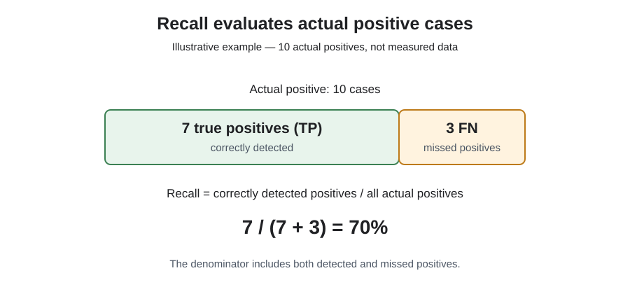

## Definition

Recall, also called sensitivity or the true positive rate (TPR), is the fraction of actual positive cases that a classifier correctly identifies [1, 2].

## Calculation

For binary classification, let $TP$ be true positives and $FN$ be false negatives. Recall is:

$$
\text{Recall} = \frac{TP}{TP+FN}.
$$

For example, if 7 of 10 actual positive cases are predicted positive, recall is $7/(7+3)=0.7$, or 70%.

Source: Original constructed example, based on the recall definition in Google ML Crash Course [1] and scikit-learn [2]; values are illustrative, not measured data.

## Interpretation

Recall answers: “Of the cases that are actually positive, what fraction did the classifier identify?” Its denominator is all actual positives, $TP+FN$, in the [confusion matrix](../C/Confusion%20Matrix.md) convention used here.

High recall means few actual positives are missed. It can be important when false negatives are costly, such as when screening for a condition that requires follow-up [1].

Recall is different from [precision](../P/Precision.md): recall measures the detection of actual positives, while precision measures the correctness of positive predictions.

## Necessity

Recall is useful when identifying as many actual positive cases as possible is a priority. Assess it alongside precision and the number of false positives, because a classifier can achieve higher recall by labeling more cases as positive.

## Limitations and Alternatives

- **It does not measure false alarms:** Recall does not directly account for false positives or true negatives.
- **It depends on the threshold:** Changing the classification threshold changes predicted labels and can change recall [1].
- **It may trade off with precision:** A threshold change that finds more positives can also produce more false positives; select an operating point based on the task's costs.
- **It can be undefined:** If there are no actual positive cases, $TP+FN=0$. Metric implementations may use different documented conventions for this case [2].
- **Multiclass averaging must be stated:** Recall can be calculated per class and aggregated in different ways; report the averaging method [2].
- **It is sample-dependent:** The estimated recall can vary, especially when the evaluation sample contains few actual positives.

## Derived Subsequent Concepts

- [**Classification Metrics**](../C/Classification%20Metrics.md): Places recall alongside accuracy, precision, F1, and other measures.
- [**Confusion Matrix**](../C/Confusion%20Matrix.md): Supplies the TP and FN counts used in recall.
- [**Precision**](../P/Precision.md): The fraction of predicted positives that are actually positive.
- [**F1 Score**](../F/F1%20Score.md): A harmonic-mean summary of precision and recall.
- **ROC Curve and ROC-AUC:** Compare true positive rates with false positive rates across thresholds.
- **Classification Threshold:** A score cutoff that affects which cases are predicted positive.

## References

1. Google for Developers. [Classification: Accuracy, recall, precision, and related metrics](https://developers.google.com/machine-learning/crash-course/classification/accuracy-precision-recall).
2. Scikit-learn Developers. [recall_score documentation](https://scikit-learn.org/stable/modules/generated/sklearn.metrics.recall_score.html).
