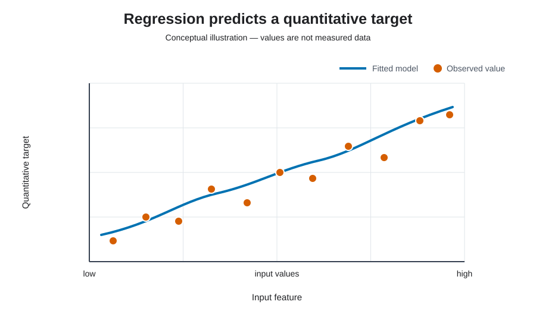
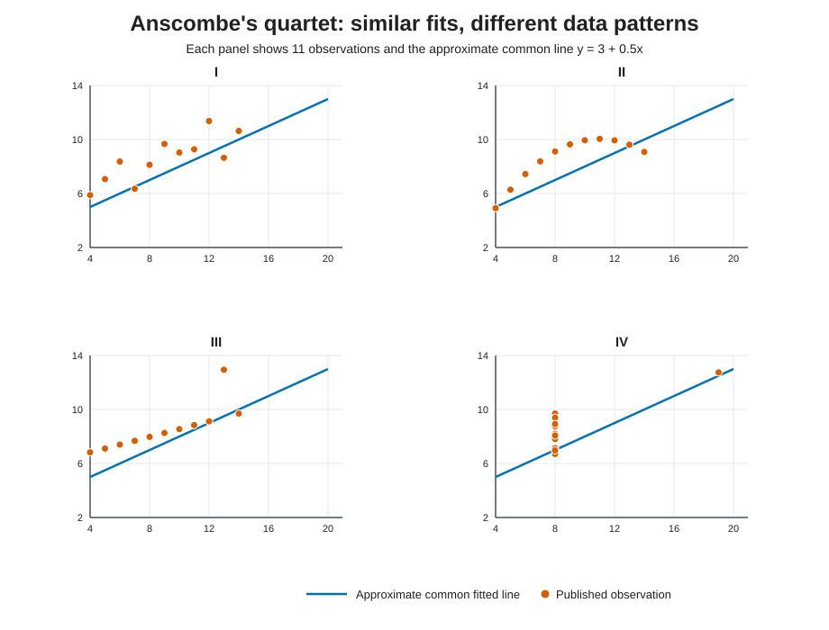

## Definition

Regression is a supervised learning task in which a model uses input features (also called predictors) to predict a quantitative target (also called a response or label). For example, a model can use a car's weight and other characteristics to predict its fuel efficiency [1].

Regression describes the kind of prediction being made, not one particular model. Linear regression models the target using a function that is linear in its fitted coefficients; it can include transformed features, while other model families can capture relationships in different ways and still predict a quantitative target [1, 2, 3].

## Calculation

For simple linear regression with one feature $x$, the prediction has the form:

$$
\hat{y} = \hat{\beta}_0 + \hat{\beta}_1 x,
$$

where $\hat{\beta}_0$ is the fitted intercept and $\hat{\beta}_1$ is the fitted slope. Under ordinary least squares (OLS), these coefficients minimize the sum of squared residuals:

$$
\sum_{i=1}^{n}(y_i-\hat{y}_i)^2,
\qquad
\hat{\beta}_1 =
\frac{\sum_{i=1}^{n}(x_i-\bar{x})(y_i-\bar{y})}
{\sum_{i=1}^{n}(x_i-\bar{x})^2},
\qquad
\hat{\beta}_0 = \bar{y}-\hat{\beta}_1\bar{x}.
$$

This is one specific regression method and loss; other models and training procedures use other forms [1, 2, 3].

Source: Original conceptual illustration; plotted points and curve are illustrative, not measured data.

### Worked Example: Anscombe's Quartet

Anscombe's quartet is a well-known example of four datasets with very similar summary statistics and fitted linear regressions but substantially different plotted patterns [4, 5]. In the first dataset, the 11 observations have $\bar{x}=9$, $\bar{y}\approx7.5009$, $\sum_i(x_i-\bar{x})^2=110$, and $\sum_i(x_i-\bar{x})(y_i-\bar{y})=55.01$. The OLS slope is therefore approximately $55.01/110=0.5001$, and the intercept is approximately $7.5009-(0.5001)(9)=3.0001$.

The fitted line is approximately $\hat{y}=3.0001+0.5001x$. For $x=10$, it predicts $\hat{y}\approx8.001$; the observed value is $y=8.04$, so the residual $y-\hat{y}$ is about $0.039$. The quartet's four fitted lines and summary statistics are nearly identical, even though their scatterplots differ, which is why a regression summary should be considered alongside a visualization [4, 5].

Source: Original plot of Anscombe's quartet data documented in R's datasets package [4], first published by Anscombe [5]. The fitted lines are shown as the common approximation $\hat{y}=3+0.5x$.

## Interpretation

The model's output is a numerical prediction, and its quality is assessed by comparing predictions with observed target values. In a simple linear model, the slope describes the fitted change in prediction for a one-unit increase in $x$; it does not, by itself, establish a causal effect. The intercept is the fitted prediction at $x=0$, which may not be meaningful if zero is outside the data's relevant range.

The loss used to fit a model and the metrics used to evaluate its predictions affect how errors are summarized. Squared-error methods give large residuals more influence than absolute-error methods. Fit statistics alone also do not show whether a model's assumptions or shape are suitable, as Anscombe's quartet illustrates [4, 5].

## Necessity

Regression is appropriate when the task is to estimate a numerical quantity rather than assign an example to a category. The model's predicted values can support forecasting or estimation, while the evaluation method should reflect the costs and scale of errors in the application.

## Limitations and Alternatives

- **A numeric prediction is not necessarily a plausible value:** A model can produce values outside a target's feasible range unless its structure or post-processing prevents this.
- **Results depend on modeling and data choices:** Features, model assumptions, training data, and the loss function all affect the fitted relationship and predictions.
- **A fitted relationship is not automatically causal:** Association between a feature and a target does not show that changing the feature causes the predicted change.
- **Extrapolation can be unreliable:** A model fitted over one range of feature values may not describe the relationship outside that range.
- **Error measures emphasize errors differently:** A single summary score may hide systematic errors or a small number of large errors; examine the metric and residual behavior relevant to the task.
- **It is distinct from classification:** Classification predicts class labels or class-related scores. Regression and classification can share model families or training techniques, but their targets and evaluation measures differ [2, 3].

## Derived Subsequent Concepts

- [**Bias-Variance Tradeoff**](../B/Bias-Variance%20Tradeoff.md): A framework for understanding prediction error in settings including regression with squared-error loss.
- [**Underfitting**](../U/Underfitting.md): Occurs when a fitted model fails to capture relevant structure in the data.
- [**Overfitting**](../O/Overfitting.md): Occurs when a model fits training-specific patterns that do not generalize.
- [**Generalization**](../G/Generalization.md): The ability to make useful predictions on data not used to fit the model.
- [**Classification Metrics**](../C/Classification%20Metrics.md): Describes measures for classification, in contrast to regression evaluation measures.

## References

1. Google for Developers. [Linear regression](https://developers.google.com/machine-learning/crash-course/linear-regression).
2. Scikit-learn Developers. [Supervised learning](https://scikit-learn.org/stable/supervised_learning.html).
3. National Institute of Standards and Technology. [Linear Least Squares Regression](https://www.itl.nist.gov/div898/handbook/pmd/section1/pmd141.htm).
4. R Core Team. [Anscombe's Quartet of 'Identical' Simple Linear Regressions](https://stat.ethz.ch/R-manual/R-devel/library/datasets/html/anscombe.html).
5. Anscombe, F. J. (1973). [Graphs in Statistical Analysis](https://doi.org/10.1080/00031305.1973.10478966). *The American Statistician*, 27(1), 17–21.
