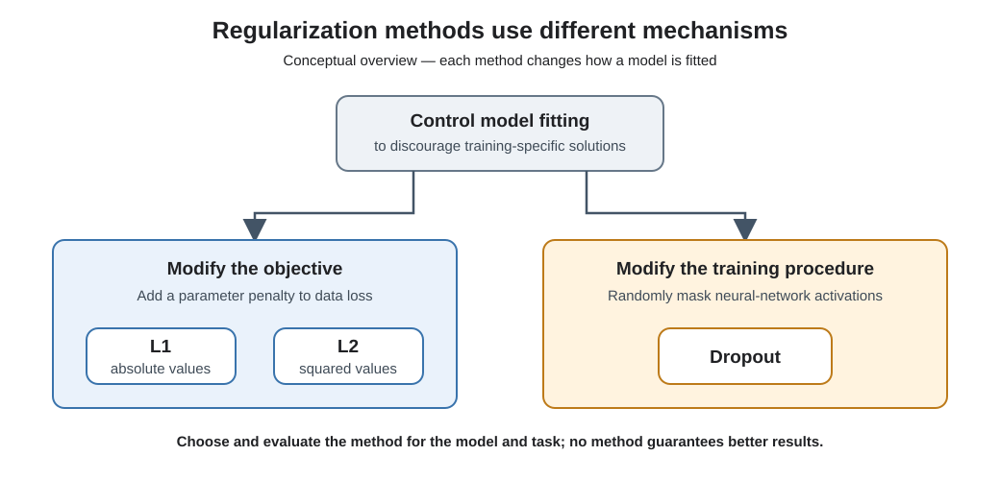

## Definition

Regularization is a family of methods that modify a model's fitting objective or training procedure to discourage overly complex or training-specific solutions. It is often used to reduce [overfitting](../O/Overfitting.md), with the aim of improving performance on new data; improvement is not guaranteed and must be evaluated [1, 2, 3].

The term covers methods with different mechanisms. [L1 regularization](../L/L1%20Regularization.md) and [L2 regularization](../L/L2%20Regularization.md) add parameter penalties to an objective, while [Dropout](../D/Dropout.md) randomly masks neural-network activations during training.

## Calculation

A common explicit-penalty form combines an unregularized data loss $L(\mathbf{w})$ with a penalty $\Omega(\mathbf{w})$:

$$
J(\mathbf{w}) = L(\mathbf{w}) + \lambda\Omega(\mathbf{w}), \qquad \lambda \geq 0.
$$

For L1 regularization, $\Omega(\mathbf{w})=\|\mathbf{w}\|_1$; for the common squared L2 penalty, $\Omega(\mathbf{w})=\|\mathbf{w}\|_2^2$. The parameter $\lambda$ controls the penalty's strength in this convention. Larger values place more emphasis on the penalty relative to the data loss, although implementations may scale the loss or penalty differently [1, 2].

Not every regularization method is expressed by adding a fixed penalty to the objective. Dropout, for example, changes the training procedure by randomly setting selected activations to zero [3].

Source: Original conceptual diagram for this entry, based on the L1 and L2 objective forms documented by scikit-learn [1, 2] and the dropout procedure described by Srivastava et al. [3].

## Interpretation

Regularization changes the fitting process so that matching the training data is not the only consideration. In explicit-penalty methods, fitting is balanced against a preference encoded by the penalty. L1 can encourage exact zero coefficients, while L2 generally shrinks coefficients without setting them exactly to zero. Dropout instead trains neural networks with randomly masked activations [1, 2, 3].

These approaches are not interchangeable. Their effects depend on the model, data, objective, and training procedure.

## Necessity

A model can fit training observations well yet perform poorly on unseen observations. Regularization provides one set of tools for controlling that fit and may help reduce overfitting. Select its form and strength using validation data or cross-validation, and assess the final model on data not used for those choices [4].

## Limitations and Alternatives

- **It can cause underfitting:** Excessive regularization can constrain a model so much that it fails to capture useful patterns.
- **It does not guarantee better generalization:** A penalty or stochastic procedure is not a substitute for representative evaluation data.
- **Strengths are implementation-dependent:** Loss scaling, penalty conventions, and parameter names vary, so nominal strength values may not be comparable across implementations.
- **Methods have different effects:** L1, L2, and dropout act on different parts of model fitting; the appropriate choice depends on the model and task.
- **Other approaches exist:** Data augmentation, early stopping, and architectural constraints can also control fitting, but their suitability depends on the learning problem.

## Derived Subsequent Concepts

- [**L1 Regularization**](../L/L1%20Regularization.md): Adds a penalty on absolute parameter values and can encourage sparse linear models.
- [**L2 Regularization**](../L/L2%20Regularization.md): Adds a squared-parameter penalty that generally shrinks coefficients.
- [**Dropout**](../D/Dropout.md): Regularizes neural-network training by randomly masking activations.
- [**Overfitting**](../O/Overfitting.md): A pattern regularization may help address, where training fit fails to transfer to unseen data.
- [**Generalization**](../G/Generalization.md): The ability to perform usefully on data not used to fit a model.

## References

1. Scikit-learn Developers. [Linear Models: Lasso](https://scikit-learn.org/stable/modules/linear_model.html#lasso).
2. Scikit-learn Developers. [Linear Models: Ridge regression and classification](https://scikit-learn.org/stable/modules/linear_model.html#ridge-regression-and-classification).
3. Srivastava, N., Hinton, G., Krizhevsky, A., Sutskever, I., & Salakhutdinov, R. (2014). [Dropout: A Simple Way to Prevent Neural Networks from Overfitting](https://jmlr.org/papers/v15/srivastava14a.html). *Journal of Machine Learning Research*, 15(56), 1929–1958.
4. Scikit-learn Developers. [Cross-validation: evaluating estimator performance](https://scikit-learn.org/stable/modules/cross_validation.html).
