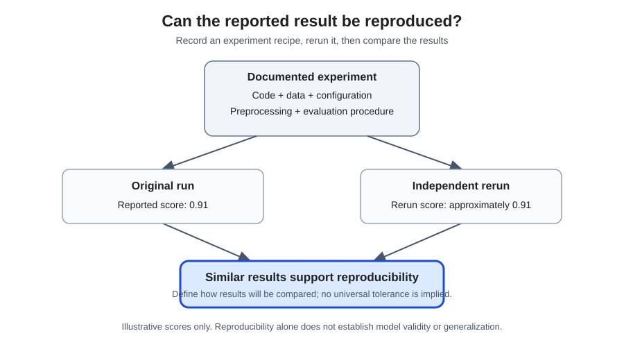

## Definition

In machine learning research, reproducibility commonly means obtaining similar results to a reported study using the same code and data when available [1]. A reproducible report therefore documents enough of the experiment to make its procedure and results checkable.

## Calculation

Reproducibility has no single numerical formula. To make a training result checkable, record the information needed to reconstruct the experiment, such as:

- the code version and data version;
- preprocessing and train, validation, and test splits;
- model configuration and [hyperparameters](../H/Hyperparameter.md);
- random seeds and relevant software or hardware details;
- the evaluation procedure, metrics, and reported results.

For example, [experiment tracking](../E/Experiment%20Tracking.md) can associate a metric with the code, data, and configuration used for that run. Re-running the recorded procedure and comparing the resulting metrics provides evidence about whether the result can be reproduced [1].

Source: Original schematic illustrating the reproducibility definition in [1]. The scores shown are hypothetical.

## Interpretation

- Similar results on a rerun support the reliability of the reported experiment, but do not by themselves prove that the model generalizes or that the original method is valid.
- Exact numerical identity is not always expected: randomized training and hardware or software differences may lead to small variations. The acceptable comparison should be explained rather than assumed to have a universal tolerance.
- Reproducing a result depends on access to the relevant code and data, along with enough detail to interpret and evaluate them [1].

## Necessity

Reproducibility allows researchers and practitioners to check reported findings, detect unintentional errors, and build on prior work. Clear reporting of the experimental procedure supports this process [1].

## Limitations and Alternatives

- **Incomplete materials impede reproduction:** Missing code, data, preprocessing, or evaluation details can prevent an independent rerun.
- **Similar results are not a guarantee of validity:** An experiment can be reproducible and still use an unsuitable metric, biased sample, or flawed evaluation design.
- **Randomness complicates exact matching:** Recording a random seed helps document an experiment, but does not ensure bit-for-bit identical results across software and hardware environments.
- **Terminology varies:** Research communities do not always use “reproducibility” and related terms in exactly the same way; state what materials and comparison a claim refers to.

## Derived Subsequent Concepts

- [**Experiment Tracking**](../E/Experiment%20Tracking.md): Records run settings and outcomes that help make experiments checkable.
- [**Hyperparameter**](../H/Hyperparameter.md): A training or model setting that should be documented when it affects a reported run.
- [**Generalization**](../G/Generalization.md): Performance on observations not used to fit a model; this is distinct from reproducing a reported experiment.
- **Machine Learning Reproducibility Checklist:** A structured way to report experimental methods and materials [1].

The concept map shows how recorded materials enable a rerun whose results can be compared with the report:

## References

1. Pineau, J., et al. (2021). [Improving Reproducibility in Machine Learning Research: A Report from the NeurIPS 2019 Reproducibility Program](https://jmlr.org/papers/v22/20-303.html). *Journal of Machine Learning Research*, 22(164), 1–20.
