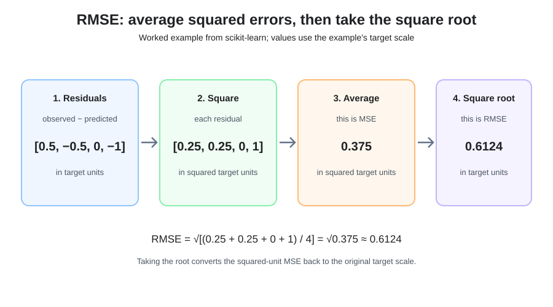

## Definition

Root mean squared error (RMSE) is the square root of the average squared difference between observed numeric targets and model predictions. It is a regression loss and evaluation metric [1].

## Calculation

For $n$ observations, let $y_i$ be the observed value and $\hat{y}_i$ its prediction. Then:

$$
\text{RMSE} =
\sqrt{\frac{1}{n}\sum_{i=1}^{n}(y_i-\hat{y}_i)^2}.
$$

Using the scikit-learn example also used for [MSE](../M/Mean%20Squared%20Error.md), the observed values are $[3,-0.5,2,7]$, the predictions are $[2.5,0,2,8]$, and the MSE is $0.375$ [1, 2]. Therefore:

$$
\text{RMSE} = \sqrt{0.375} \approx 0.6124.
$$

If the target is measured in some unit, RMSE has that same unit; in this example, it is in the units of the target values.

Source: Original schematic of the scikit-learn example values [1, 2].

## Interpretation

RMSE aggregates residual sizes into a nonnegative summary, with a value of zero only for perfect predictions. Squaring residuals before averaging makes large errors contribute disproportionately, and taking the square root returns the result to the target's scale [1].

For the same single target and evaluation observations, RMSE and [mean squared error](../M/Mean%20Squared%20Error.md) rank models identically because the square-root function is increasing. RMSE is often easier to interpret than MSE, but it is not the average absolute error.

## Necessity

RMSE is useful when a single error summary in the target's units is desired and larger errors should be penalized more heavily than smaller ones. For instance, an RMSE of $5{,}000$ in a target measured in dollars can be interpreted as a typical scale of prediction error, although it is not the average absolute error.

## Limitations and Alternatives

- **Sensitive to large errors:** Squaring gives unusually large residuals a strong influence; inspect residuals when outliers or rare large errors matter.
- **Scale-dependent:** RMSE uses the target's units, so raw values are not generally comparable across targets with different units or scales.
- **Not a complete description of errors:** The same RMSE can result from different residual patterns and does not indicate whether errors are systematically positive or negative.
- **Alternatives express different priorities:** [MSE](../M/Mean%20Squared%20Error.md) keeps the squared scale, while [MAE](../M/Mean%20Absolute%20Error.md) weights absolute residuals linearly. [Regression Metrics](./Regression%20Metrics.md) compares these measures.

## Derived Subsequent Concepts

- [**Mean Squared Error (MSE)**](../M/Mean%20Squared%20Error.md): RMSE is the square root of this metric.
- [**Mean Absolute Error (MAE)**](../M/Mean%20Absolute%20Error.md): A linear-in-error alternative.
- [**Regression Metrics**](../R/Regression%20Metrics.md): Compares RMSE with other measures of regression performance.
- [**Regression**](./Regression.md): The quantitative prediction task RMSE can evaluate.

## References

1. Scikit-learn Developers. [root_mean_squared_error documentation](https://scikit-learn.org/stable/modules/generated/sklearn.metrics.root_mean_squared_error.html).
2. Scikit-learn Developers. [mean_squared_error documentation](https://scikit-learn.org/stable/modules/generated/sklearn.metrics.mean_squared_error.html).
