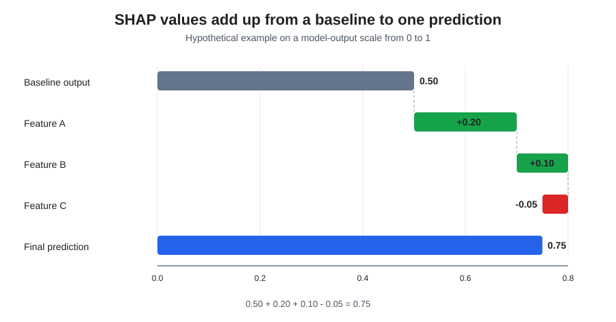
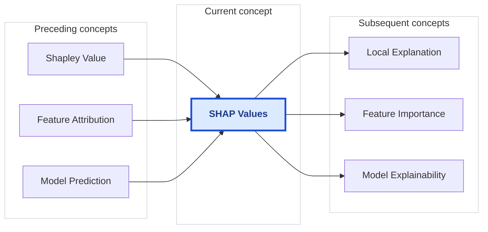

## Definition

SHAP (SHapley Additive exPlanations) assigns each feature an attribution value for a particular model prediction. It applies Shapley values from cooperative game theory to explain how features contribute to the difference between a baseline prediction and the prediction being explained [1].

### SHAP and Shapley Values

A **Shapley value** is a cooperative-game solution concept: it allocates a game's value among its players by averaging each player's marginal contribution across coalitions. **SHAP** is a framework for explaining model predictions that treats input features as players and defines the coalition value through the model and a rule for handling hidden features [1, 2]. In short, the Shapley value is the mathematical idea; SHAP applies it to feature attribution.

The terms are related but not interchangeable. A Shapley value can describe an allocation in any cooperative game, not just a machine-learning explanation. A SHAP value is a Shapley attribution for a particular model-output game. Its meaning depends on choices such as the background data, how hidden features are represented, whether feature dependence is respected, and the output or link scale [2, 3]. Thus, the paper's uniqueness result for additive explanations under its stated properties does not make SHAP attributions independent of these modeling choices [1].

## Calculation

For a prediction at input $x$, the Shapley value for feature $i$ is:

$$
\phi_i =
\sum_{S\subseteq F\setminus\{i\}}
\frac{|S|!(M-|S|-1)!}{M!}
\left[f_x(S\cup\{i\})-f_x(S)\right],
$$

where $F$ is the set of $M$ features, $S$ is a subset that does not contain feature $i$, and $f_x(S)$ is the model output when the features in $S$ are known and the remaining features are handled by a defined value function [1].

The additive explanation is:

$$
f(x)=\phi_0+\sum_{i=1}^{M}\phi_i,
$$

where $\phi_0$ is the expected model output used as the baseline. For example, on a model-output scale where the baseline is $0.50$, hypothetical feature contributions of $+0.20$, $+0.10$, and $-0.05$ sum to a prediction of $0.75$.

Source: Original schematic of the illustrative additive calculation; the values are hypothetical, not from an actual model.

## Interpretation

- A positive SHAP value moves the explained model output above its baseline; a negative value moves it below the baseline.
- SHAP values explain a particular model output for a particular prediction, under the chosen way of defining the baseline and missing-feature values.
- Summarizing absolute SHAP values across many examples can describe global feature influence, but it does not replace inspecting individual explanations or the evaluation goal [1].

## Necessity

SHAP values provide a unified way to attribute an individual prediction across features, including for complex models. They can help inspect model behavior, compare feature contributions, and investigate unexpected predictions [1].

## Limitations and Alternatives

- **They are not causal effects:** A feature attribution describes how the model output is allocated under the SHAP definition; it does not show that changing the feature would cause the same change in the real world.
- **The reference and missing-feature treatment matter:** Different background data or assumptions about dependent features define different coalition values and can produce different attributions [2, 3].
- **Exact calculation can be expensive:** The Shapley definition considers feature subsets; practical methods may use specialized algorithms or approximations for larger models [1].
- **The output scale matters:** Explanations may be expressed on different model-output scales, such as probability or log-odds. Interpret the baseline and attributions on the scale actually used.
- **An attribution is not a fairness verdict:** SHAP can help inspect predictions, but fairness requires task- and context-specific evaluation beyond feature contributions.

## Derived Subsequent Concepts

- **Shapley Value:** A cooperative-game allocation that averages a feature's marginal contribution across subsets of other features [1].
- **Feature Attribution:** A decomposition that assigns contributions to inputs for a particular model output.
- **Feature Importance:** A broader family of methods for summarizing feature relevance; global summaries of SHAP values are one possible approach.
- **Model Explainability:** The broader goal of making model behavior understandable to people.

The concept map shows prerequisite ideas and concepts that build on SHAP values:

## References

1. Lundberg, S. M., & Lee, S.-I. (2017). [A Unified Approach to Interpreting Model Predictions](https://proceedings.neurips.cc/paper/2017/hash/8a20a8621978632d76c43dfd28b67767-Abstract.html). *Advances in Neural Information Processing Systems 30*, 4765–4774.
2. SHAP documentation. [shap.Explainer](https://shap.readthedocs.io/en/latest/generated/shap.Explainer.html).
3. SHAP documentation. [shap.LinearExplainer](https://shap.readthedocs.io/en/latest/generated/shap.LinearExplainer.html).
