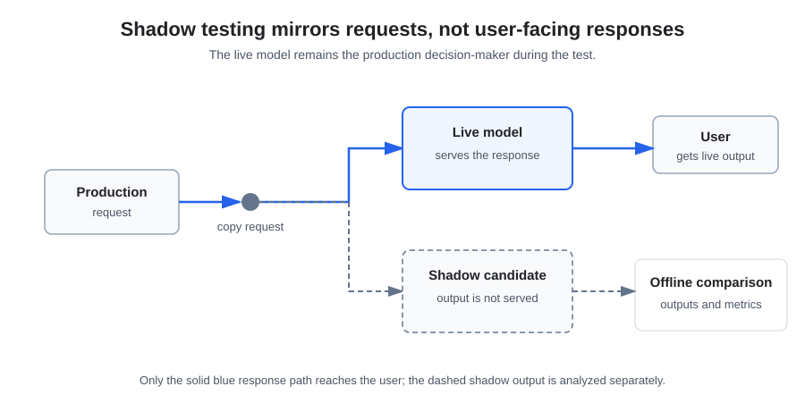
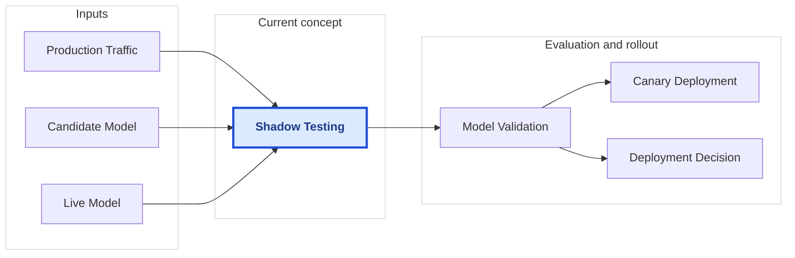

## Definition

Shadow testing, also called shadow deployment or traffic mirroring, sends copies of live requests to a candidate model while the current production model remains responsible for user-facing responses. The candidate runs alongside the live model; its responses are recorded or analyzed but are not returned to the requesting user [1].

This allows teams to observe candidate behavior on production-like inputs without routing user-visible decisions to it. The candidate is being tested in a production environment, but it is not yet serving as the production decision-maker.

## Calculation

There is no single score for shadow testing. Teams can compare candidate and production outputs and monitor operational measures such as errors, latency, and resource use. For classification, one simple comparison is the fraction of requests for which the models predict different labels:

$$
D = \frac{1}{N}\sum_{i=1}^{N}\mathbb{1}\left[f_{\text{candidate}}(x_i)\ne f_{\text{production}}(x_i)\right],
$$

where $x_i$ is a mirrored request and $N$ is the number of requests compared. If the models disagree on 12 of 1,000 requests, then $D=12/1000=0.012$, or $1.2\%$. This measures disagreement, not which model is correct. Evaluating correctness requires suitable reference labels or outcomes, which may only become available later.

Source: Original schematic of the traffic-mirroring workflow described in [1].

## Interpretation

- The live model's response remains on the user-facing path; the candidate's output is used for testing and comparison.
- Mirrored requests reveal how the candidate behaves on real request patterns, but agreement with the current model does not prove correctness or quality.
- Shadow testing differs from a canary release: a canary serves the changed version to a limited portion of users or production traffic, while a shadow candidate's responses are not served [2].

## Necessity

Offline evaluation may not capture the full range of production inputs or operational conditions. Shadow testing can expose differences, failures, or performance issues on live traffic before a candidate is allowed to affect user-facing decisions [1, 2].

## Limitations and Alternatives

- **It does not measure user outcomes:** Since candidate responses are not served, the test cannot directly show how users would respond to them. Delayed outcomes or labeled evaluation may still be needed.
- **Output disagreement is not a quality verdict:** A difference from the live model identifies behavior to investigate, not an error by itself.
- **Mirroring adds load and data-handling obligations:** Candidate inference consumes resources, and copied requests must be handled under the same privacy and security requirements as the original traffic.
- **Prevent unintended side effects:** The candidate should not make duplicate changes to shared state or trigger user-facing actions while processing mirrored requests.
- **It is not a substitute for a canary or A/B test:** Those methods expose a candidate to user-facing traffic or outcomes; shadow testing deliberately does not [2].

## Derived Subsequent Concepts

- **Traffic Mirroring:** Sending a copy of a request to another service or model while retaining the primary response path [1].
- **Canary Deployment:** A limited, time-bound release evaluated on a subset of production traffic or users [2].
- **Model Validation:** Assessing a trained model's quality and suitability against defined criteria before broader release.
- **Model Deployment:** Making a model available for inference in a production environment.

The concept map shows production traffic and a candidate model as inputs to shadow testing, which informs model validation and a later rollout choice:

## References

1. Istio Authors. [Mirroring](https://istio.io/latest/docs/tasks/traffic-management/mirroring/).
2. Warner, A., Davidovič, Š., et al. [Canarying Releases](https://sre.google/workbook/canarying-releases/). *The Site Reliability Workbook*, Chapter 16. Google.
