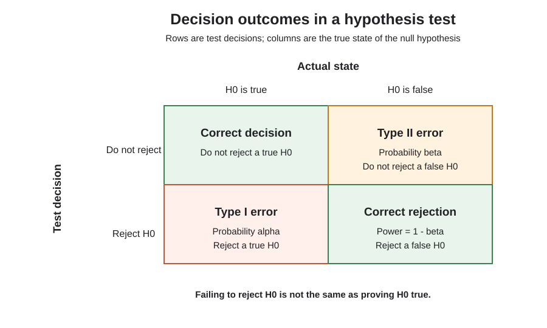

## Definition

A Type I error occurs when a hypothesis test rejects the null hypothesis $H_0$ even though $H_0$ is true. Its probability is denoted by $\alpha$ and is called the test's Type I error rate or significance level [1].

## Calculation

The Type I error probability is conditional on the null hypothesis being true:

$$
\alpha = P(\text{reject } H_0 \mid H_0 \text{ is true}).
$$

A test performed at significance level $\alpha$ is designed to control this probability under its assumptions. The possible decisions and outcomes are:

| Test decision | $H_0$ is true | $H_0$ is false |
|---|---|---|
| Do not reject $H_0$ | Correct decision | Type II error ($\beta$) |
| Reject $H_0$ | Type I error ($\alpha$) | Correct rejection (power $1-\beta$) |

Source: Original schematic for this entry, based on the hypothesis-testing outcome table in OpenStax [1].

## Interpretation

The significance level is a long-run error-rate control under the null hypothesis and the test's assumptions. For example, a test with $\alpha=0.05$ is designed so that its Type I error probability is at most 5% when the null hypothesis is true. This is not the probability that a particular null hypothesis is true, nor the probability that a specific rejection is wrong [1].

In a binary classification problem, a Type I error corresponds to a [false positive](../C/Confusion%20Matrix.md) only when predicting the positive class has the same meaning as rejecting $H_0$.

## Necessity

Choosing a significance level makes the tolerated rate of false rejection explicit. Its choice should reflect the consequences of a false positive, the study design, and the need to detect meaningful alternatives; a conventional value is not automatically appropriate for every problem [1].

## Limitations and Alternatives

- **It is conditional on $H_0$:** The Type I error rate does not state the probability that $H_0$ is true after seeing data.
- **It depends on assumptions:** A test's nominal significance level controls its error rate only when the test conditions and procedure are appropriate.
- **It trades off with Type II error:** For a fixed sample size and test procedure, making rejection harder generally reduces Type I errors but can increase Type II errors for alternatives of interest. Increasing sample size can help improve power [1].
- **Multiple testing matters:** Performing many tests can increase the chance of at least one false rejection. Procedures such as Holm's method can control the family-wise error rate across a set of tests [2].
- **Do not conflate terms across settings:** A false positive in classification is a Type I error only when the decision is explicitly framed as rejecting a null hypothesis.

## Derived Subsequent Concepts

- **Type II Error:** Failing to reject a false null hypothesis; its probability is commonly denoted by $\beta$.
- **Significance Level:** The prespecified upper bound on the Type I error probability for a test.
- **Statistical Power:** The probability of rejecting a false null hypothesis, often written as $1-\beta$.
- **P-value:** A quantity used to assess how incompatible observed data are with a null model; it is compared with a chosen significance level under a testing procedure.

## References

1. OpenStax. [Introductory Statistics, Section 9.2: Outcomes and the Type I and Type II Errors](https://openstax.org/books/introductory-statistics/pages/9-2-outcomes-and-the-type-i-and-type-ii-errors).
2. R Core Team. [Adjust P-values for Multiple Comparisons](https://stat.ethz.ch/R-manual/R-devel/library/stats/html/p.adjust.html).
