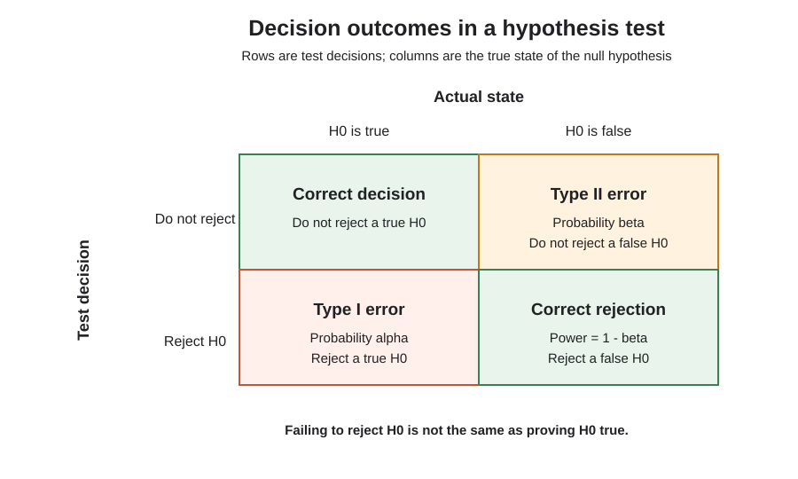

## Definition

A Type II error occurs when a hypothesis test does not reject the null hypothesis $H_0$ even though $H_0$ is false. Its probability is denoted by $\beta$ [1].

## Calculation

For a specified alternative hypothesis, the Type II error probability is:

$$
\beta = P(\text{do not reject } H_0 \mid H_0 \text{ is false}).
$$

The test's power against that alternative is the probability of correctly rejecting $H_0$:

$$
\text{Power} = 1-\beta.
$$

Source: Original schematic created for the [Type I Error entry](./Type%20I%20Error.md), based on the hypothesis-testing outcome table in OpenStax [1].

## Interpretation

A Type II error means the test did not find sufficient evidence to reject $H_0$ when an alternative was true. It does not show that $H_0$ is true: failure to reject may result from limited information or a test with low power [1].

In a binary classification problem, a Type II error corresponds to a [false negative](../C/Confusion%20Matrix.md) only when predicting the negative class has the same meaning as failing to reject $H_0$.

## Necessity

Considering Type II error and power helps determine whether a study is designed to detect effects that matter. Sample-size planning can account for the chosen significance level, variability, and a specified alternative; increasing sample size can increase power under appropriate conditions [1].

## Limitations and Alternatives

- **It depends on the alternative:** Unlike a fixed significance level, $\beta$ and power vary with the particular alternative, effect size, and test procedure.
- **It does not mean the null is accepted:** A non-significant result alone is not evidence that the null hypothesis is true.
- **It trades off with Type I error:** For a fixed sample size and test procedure, lowering the Type I error rate generally makes rejection harder and may increase Type II error for alternatives of interest.
- **False negatives are context-dependent:** A false negative in classification is a Type II error only when the classification decision corresponds to a hypothesis test with a clearly defined null.

## Derived Subsequent Concepts

- [**Type I Error**](./Type%20I%20Error.md): Rejecting a true null hypothesis; its probability is commonly denoted by $\alpha$.
- **Statistical Power:** The probability of rejecting a false null hypothesis, equal to $1-\beta$ for a specified alternative.
- **Significance Level:** The target upper bound on the Type I error probability.
- **Sample-Size Planning:** Choosing the number of observations to achieve a desired power under specified assumptions.

## References

1. OpenStax. [Introductory Statistics, Section 9.2: Outcomes and the Type I and Type II Errors](https://openstax.org/books/introductory-statistics/pages/9-2-outcomes-and-the-type-i-and-type-ii-errors).
