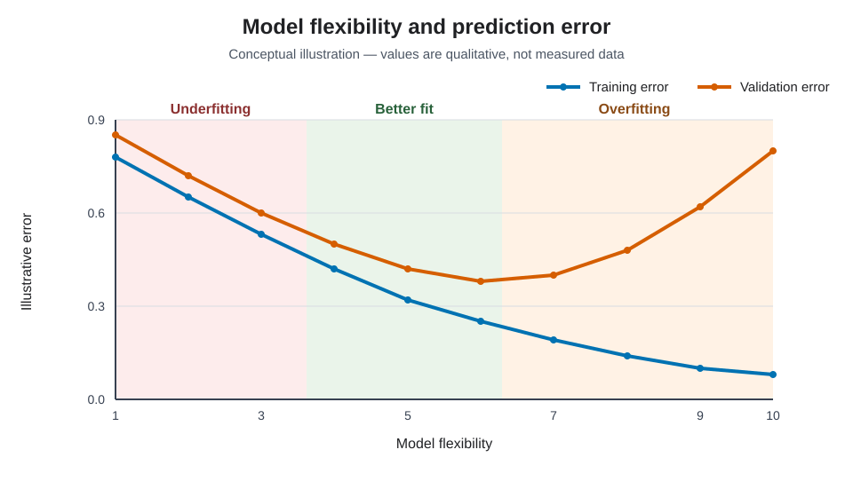

## Definition

Underfitting occurs when a fitted model is too limited to capture patterns needed for the prediction task. It commonly appears as poor performance on both training data and unseen data, and is often associated with high bias [1, 2].

Underfitting is a description of a model's inadequate fit, not a diagnosis of a single cause. It can result from an overly restrictive model, uninformative features, excessive regularization, or an optimization procedure that has not adequately fitted the model.

## Calculation

There is no universal numerical cutoff for underfitting. Evaluate the model with the task's chosen loss or metric on both training data and held-out validation data, using the same evaluation protocol. When both scores indicate poor performance relative to a useful baseline or task requirement, underfitting is one possible explanation [1].

In a polynomial regression example, a linear function may be too simple to approximate a nonlinear target, while a more suitable intermediate-degree polynomial captures it better. A very high-degree polynomial can instead fit training noise and overfit, so increasing model complexity without validation is not a reliable remedy [1].

*Source: Original schematic created for this entry, not copied from the cited work. Its model-complexity pattern is informed by Hastie et al. [3]; the curves are qualitative, not measured data.*

## Interpretation

Underfitting means the model has not learned enough of the signal relevant to its task. High training error is an important clue: unlike the common overfitting pattern, the model already performs poorly on the data used to fit it. A similarly poor validation score supports the diagnosis, though neither pattern alone proves its cause.

The bias-variance tradeoff provides one perspective: a model with insufficient flexibility often has high bias. However, underfitting can also stem from feature representation, data quality, or optimization, so model capacity is not the only factor to examine [2].

## Necessity

Recognizing underfitting helps distinguish it from overfitting and choose a suitable intervention. Depending on the cause, one can use a more expressive model, improve the features or representation, reduce excessive regularization, or improve optimization. Re-evaluate each change on held-out data or with cross-validation to check whether generalization improves.

## Limitations and Alternatives

- **Scores need context:** “Poor” performance depends on the metric, a baseline, and the task's requirements; there is no universal error threshold.
- **A single split can mislead:** Validation scores vary with the split and may not represent the deployment distribution. Cross-validation can provide a more stable comparison when appropriate.
- **High bias is an association, not a direct measurement:** Training and validation scores do not by themselves estimate the formal bias component across repeated training datasets.
- **More complexity can overfit:** Increasing model capacity or reducing regularization may lower training error while worsening performance on unseen data; compare validation performance rather than training fit alone.

## Derived Subsequent Concepts

- [**Bias-Variance Tradeoff**](../B/Bias-Variance%20Tradeoff.md): A framework for understanding how systematic prediction error and sensitivity to training data contribute to expected error [2].
- **Overfitting:** A model fits training-specific patterns and performs worse on unseen data.
- **Regularization:** Techniques that constrain fitting; [L1 regularization](../L/L1%20Regularization.md) and [L2 regularization](../L/L2%20Regularization.md) are two examples.

## References

1. Scikit-learn Developers. [Underfitting vs. Overfitting](https://scikit-learn.org/stable/auto_examples/model_selection/plot_underfitting_overfitting.html).
2. Scikit-learn Developers. [Single estimator versus bagging: bias-variance decomposition](https://scikit-learn.org/stable/auto_examples/ensemble/plot_bias_variance.html).
3. Hastie, T., Tibshirani, R., & Friedman, J. (2009). *The Elements of Statistical Learning: Data Mining, Inference, and Prediction* (2nd ed.), Section 7.3. [Springer](https://doi.org/10.1007/978-0-387-84858-7).
