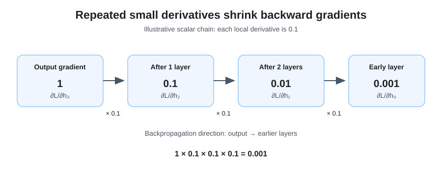
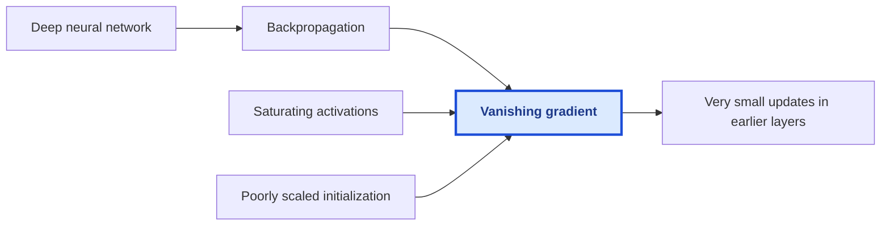

## Definition

The vanishing gradient problem occurs when gradients shrink as they are propagated backward through a deep neural network. Parameters in earlier layers then receive very small updates, which can make learning slow or stall [1].

## Calculation

For a scalar chain of layer representations $h_0,\ldots,h_L$, the chain rule gives:

$$
\frac{\partial \mathcal{L}}{\partial h_0}
=
\frac{\partial \mathcal{L}}{\partial h_L}
\prod_{\ell=1}^{L}
\frac{\partial h_\ell}{\partial h_{\ell-1}},
$$

where $\mathcal{L}$ is the loss. In a simple scalar illustration, if the output gradient is $1$ and each of three layer derivatives is $0.1$, the gradient at the earliest representation is $1 \times 0.1^3=0.001$.

Source: Original schematic of the illustrative scalar calculation above; the values are not measurements from a trained network.

## Interpretation

- Earlier layers can learn slowly because their parameter updates depend on the small gradients reaching them.
- Saturating activation functions such as the logistic sigmoid can have derivatives close to zero in saturated regions. Repeated multiplication of such derivatives can contribute to vanishing gradients in deep networks [1].
- This is a possible optimization difficulty, not an inevitable outcome for every deep network.

## Necessity

Checking gradient magnitudes across layers can help diagnose why a deep network learns slowly or stops improving. The pattern matters: very small gradients in earlier layers alongside larger gradients nearer the output are consistent with vanishing gradients [1].

## Limitations and Alternatives

- **A small gradient is not always a failure:** Gradient size depends on the model, data, loss, and training state; interpret it alongside learning progress and other diagnostics.
- **Depth is not the only factor:** Activation derivatives and the scale of layer transformations affect how gradients propagate [1].
- **Initialization and activation choices can help:** Initialization designed for a network's activation function can help preserve signal and gradient scales. Rectifier-based networks use initialization methods tailored to rectifier activations [1, 2].
- **It differs from [Exploding Gradient](../E/Exploding%20Gradient.md):** Vanishing gradients shrink during backpropagation; exploding gradients grow excessively.

## Derived Subsequent Concepts

- [**Sigmoid Function**](../S/Sigmoid%20function.md): Its derivative approaches zero in saturated regions, which can contribute to vanishing gradients.
- **Backpropagation:** The chain-rule procedure that propagates loss gradients from output layers toward earlier layers.
- [**Exploding Gradient**](../E/Exploding%20Gradient.md): The contrasting problem in which backpropagated gradients grow excessively.
- **Weight Initialization:** The choice of initial parameter values, which influences signal and gradient scales through a network.

The concept map shows factors that can contribute to vanishing gradients and a common training consequence:

## References

1. Glorot, X., & Bengio, Y. (2010). [Understanding the difficulty of training deep feedforward neural networks](https://proceedings.mlr.press/v9/glorot10a.html). *Proceedings of the Thirteenth International Conference on Artificial Intelligence and Statistics*, 9, 249–256.
2. He, K., Zhang, X., Ren, S., & Sun, J. (2015). [Delving Deep into Rectifiers: Surpassing Human-Level Performance on ImageNet Classification](https://arxiv.org/abs/1502.01852). *Proceedings of the IEEE International Conference on Computer Vision*.
